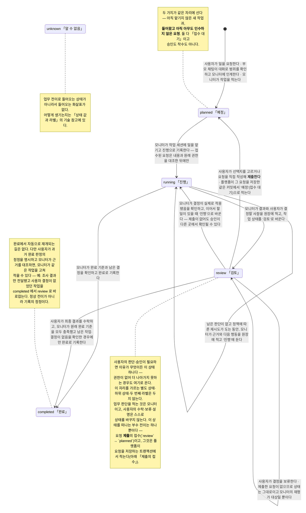
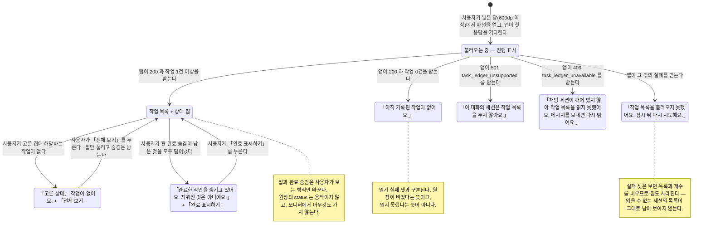

# 테스트 문서: AI 채팅 — 작업 원장의 상태

> **합의한 목표 모델 (2026-11-28 사용자 결정).** 사용자에게 판단·승인이 필요하면 **그 이유가 권한 부족이어도
> 업무 상태는 ‘검토(review)’ 하나**다. 「차단」·「대기」를 별도 상태·하위 상태·이중 라벨·중간 단계로 두지 않는다.
> 남은 판단이 없고 정책에 따른 재시도가 도는 동안은 **‘진행’에 두고** 모니터가 근거와 다음 행동을 원장에 적는다.
>
> **적용 범위**: 이 문서의 상태도·상태표·범례·화면 도표·필터·fixture·시나리오와 기대값 전부. 이 문서는 그 목표
> 모델을 기준으로 쓴다. **구현은 아직 이 모델이 아니다** — 현행 코드가 읽는 값과 보이는 칩은 아래
> 「[현행 구현과의 차이](#현행-구현과의-차이)」 한 절에만 적고, 그 변경이 배포·마이그레이션됐다고 쓰지 않는다.

이 문서가 검증하는 그림이다. 주어는 셋이다 — **사용자**, **부모 채팅**(사람과 말하는 레인), **모니터**(작업을 움직이는 레인).
이 운영 구성에서 **작업 status 를 쓰는 것은 모니터 하나**이고, 부모 채팅과 앱은 그것을 읽기만 한다.

**범례 — 사용자의 요청이 모니터에 닿는 두 경로.** 어느 쪽이든 **status 를 쓰는 것은 모니터**다.

1. **채팅으로 말한다** → 부모 채팅이 범위를 확인하고 그 원문을 `lane_ask` 로 모니터 레인의 큐에 올린다(접수 번호를 즉시 받고 기다리지 않는다).
2. **앱 작업 상세에서 요청을 저장한다** → 그 요청이 그 작업의 **다음 턴**이 되어 원장에 남고, 모니터가 원장을 볼 때 그 **열린 턴**을 발견해 접수한다. 부모 채팅을 거치지 않는다. 그 작업이 ‘검토’였다면 플랫폼이 **같은 커밋에서** ‘예정’으로 적는다(아래 「제출의 접수」).

**부모 채팅은 원장을 직접 고치지 않는다** — 두 경로 모두 기록은 모니터가 쓴다. 앱이 저장 성공을 「요청 저장됨 · 부모 확인 대기」로
말할 때의 「부모」는 **관리 세션**을 뜻하고, 사람과 말하는 부모 채팅 레인이 상태를 쓴다는 뜻이 아니다(아래 `parent` 용어 구분).

**바로 가기**: [현행 구현과의 차이](#현행-구현과의-차이) · [세 주체가 하는 일](#세-주체가-하는-일) · [상태 값과 라벨](#상태-값과-라벨) · [전이별 근거](#전이별-근거) · [패널 화면 상태](#패널-화면-상태) · [테스트 시나리오](#테스트-시나리오)

## 현행 구현과의 차이

현행 백엔드·앱은 상태 값을 **여섯 개**(`planned`·`running`·`blocked`·`review`·`completed`·`unknown`) 읽고,
`blocked` 가 적힌 작업을 「차단」 칩·배지로 보인다(`backend/internal/chat/tasks.go`·`ChatTasks.kt`). 위 목표 모델은
그 자리를 `review` 하나로 모은다. **그 변경은 아직 구현되지도, 배포·마이그레이션되지도 않았다** — 코드가
`blocked` 를 아는 값으로 읽는 동안 원장에 그 값이 남아 있으면 화면은 지금처럼 「차단」으로 보인다. 그런 **예전
기록의 원인·근거 설명은 그대로 읽는다**(작업의 「무엇을 · 왜」와 그 턴의 설명·질문).

이 절이 현행 사실을 적는 유일한 자리다. 아래의 상태표·범례·화면 도표·필터·fixture·시나리오와 기대값은 모두
**목표 모델**을 기준으로 쓰며, 「차단」을 이름만 바꾼 하위 상태·필터·두 번째 라벨로 되살리지 않는다.

## 검증 대상 AC
- AC10: 작업 패널 — 보는 방식과, 원장에 남기는 요청 (PRD-1: `prd-ai-chat.md`)
  — 이 문서는 AC10 중 **작업 원장의 상태와 그 표시**만 다룬다. 같은 AC의 선택지(원장이 쓴 문장)·작업 이력(턴)·요청
  저장의 세부는 아직 시나리오가 없다(기존 공백 — 아래 「이 문서가 다루지 않는 것」).

## 달성 가치
- V9: 개발 워크플로우 인지 부하 감소 (「파악」) — 맡긴 일이 지금 어디에 서 있는지를 대화를 되짚지 않고 본다.
- V5: 자연어 대화 기반 작업 처리 — 패널은 그 대화를 맡은 세션의 작업을 보여 주는 자리다.

## 작성 기준
- 시나리오는 **사용자가 관찰할 수 있는 결과** 단위로 쓴다. 코드 레벨 테스트는 각 시나리오의
  「관련 코드 테스트」에 참고로만 적으며, 시나리오의 검증을 대신하지 않는다.
- 「구현 상태」는 작성 시점(2026-11-28, main `ca0e9ea`) 코드를 **읽어** 적었다. 앱이나 운영 원장에서 전이를 실행해
  확인한 것이 아니다 — 실행으로 확인한 범위는 「관련 코드 테스트」가 가리키는 자동 테스트까지다.
- 작업 패널은 **안드로이드에만 있다**. iOS(`ios/PocketAide/`)에는 패널 구현이 없으므로 이 문서의 화면 시나리오는
  안드로이드에서 관찰한다. 백엔드 경로(`GET /api/chat/tasks`)는 두 앱과 무관하게 돌아간다.
  아래에서 파일명만 적은 안드로이드 코드(`ChatTasks.kt`·`ChatTaskPanel.kt`·`ChatTaskDetail.kt`·`ChatViewModel.kt`)는
  모두 `android/app/src/main/java/com/dlddu/pocketaide/chat/` 아래에 있다.
- **상태 값과 라벨은 실제 값이다** — `planned`·`running`·`review`·`completed`·`unknown` 과 「예정」·「진행」·
  「검토」·「완료」·「알 수 없음」, 그리고 「…」로 인용한 화면 문구는 코드·계약에서 그대로 옮긴 것이다. 목표 모델이
  쓰지 않는 `blocked`·「차단」은 위 「현행 구현과의 차이」에만 나온다.
  반면 작업 제목·ID(`예시-권한` …)와 건수는 시나리오를 돌리기 위한 **fixture** 이고 제품의 값이 아니다.
  fixture 는 **실 사용자의 대화나 운영 원장에 적용하지 않는다** — 읽는 사람이 상황을 재구성하기 위한 가정이다.
- 원장은 pocket-aide 의 DB에 없다. 이 대화를 맡은 `dlddu/session-platform` 세션의 슬롯 SQLite(`sp_work_tasks`·`sp_work_turns`)에
  있고, 백엔드는 읽기 전용 work 경로로 그것을 **읽기만** 한다. 그래서 사전 조건의 「원장에 … 작업이 있다」는
  **모니터가 이미 적어 둔 상태**를 뜻하며, 테스트하는 사람이 앱에서 만들 수 있는 것이 아니다.
- 시나리오 번호는 식별자(`test-ai-chat.md#시나리오 N`)의 일부다. 중간 삽입하지 말고 끝에 덧붙인다.
- 시나리오 ↔ 안드로이드 계측 테스트 대응(매칭·예외·구현 대기·공백)은 이 문서가 아니라
  `doc-tracker/` 최신 월 파일의 「e2e 매핑」 절에서 판정한다.

## 세 주체가 하는 일

| 주체 | 하는 일 (능동) | 하지 않는 일 | 근거 |
|---|---|---|---|
| **사용자** | 일을 **요청한다** — 채팅으로 말하거나(경로 1), 앱 작업 상세에서 요청을 저장한다(경로 2). 세션이 올린 선택지 중 하나를 **고른다**(앱이 요청 칸을 채울 뿐 보내지 않는다). 전달받은 결과를 **승인하거나 보류한다**. 과거 판정의 **정정을 명시한다** | status 를 직접 쓰지 않는다 — 요청·선택·승인은 모니터가 읽을 입력이다. 제출이 ‘검토’를 ‘예정’으로 **접수**시키지만 그것을 적는 것은 플랫폼의 저장 트랜잭션이고, 사용자가 status 를 고르는 것이 아니다. 업무 판단은 모니터가 적는다 | AC10 · 플랫폼 AC-N7 |
| **부모 채팅** (`parent` 레인) | 원장을 **직접 읽는다**(같은 파드·같은 DB). 사용자와 **대화해 범위를 확인한다**. 실제 결정 실행을 `lane_ask` 로 모니터 레인의 큐에 **올리고 접수 번호를 즉시 받는다**(기다리지 않는다 — 범례 경로 1). 나중에 `lane_answer` 로 그 턴의 답을 받아 사용자에게 **결과를 전달한다**. 사용자 알림·채팅 보고를 **단독으로 맡는다** | **원장을 직접 고치지 않는다** — 이 레인의 도구 표면에 `task_put`·`turn_append`·`monitor_put` 등 기록 쓰기가 없고, 인자 앞 가드가 한 번 더 거절한다. **기록을 쓰는 레인 주소**(`/session-db/mcp/lane/<role>/<incarnation>`)가 이 레인에 없고 그 주소는 플랫폼이 관리 설정에 써 모델이 읽거나 바꿀 수 없다. 모니터에 닿는 길은 `lane_ask` 하나이고, 그것은 **모니터의 큐에 턴을 올리는 길이지 원장을 고치는 길이 아니다** | 플랫폼 AC-N11 3·4·9 (`dlddu/session-platform` `docs/prd/agent-auth-pool.md`) |
| **모니터** (`monitor` 레인, 한 곳) | 두 경로로 들어온 요청을 **접수한다** — 부모가 올린 **큐의 턴**(경로 1)과, 앱이 저장해 원장에 남은 **열린 턴**(경로 2, `turn_list({open: true})`). 작업을 **작업 세션에 맡긴다**. 예약된 확인으로 **관측·근거를 모은다**. 요청과 관측을 **대조해** 작업 status 와 턴을 원장에 **기록한다**. 새 사용자 입력이 오면 그 작업을 **재평가한다** | 사용자에게 직접 말하지 않는다. `lane_ask`·`lane_answer` 를 갖지 않아 부모의 턴을 시작시키지 못한다 | 플랫폼 AC-N11 3·4·9 · `docs/session-ledger.md` 「Discovery, and the parent's order of work」 |

**정상 진입점.** 두 레인은 **세션 하나·파드 하나**이고, 진입점도 세션의 것 그대로다 — `POST /api/v1/sessions/{id}/read`·`/write`
의 본문과 `GET …/stream` 의 질의에 `lane`(`parent`·`monitor`)이 붙고, **생략하면 사람의 채팅**이다. 세션을 둘로 쪼갠 것이
아니다(플랫폼 AC-N11 1·8). 세션 분리는 별도 조사에서 **이득이 비용보다 작다고 결론**났고 그 결론은 유효하다
(`dlddu/session-platform` `docs/monitor-separation.md` — 그 문서는 조사·설계이고 분리를 구현하지 않았다).

**「단일 작성자」의 범위.** 위 표의 「모니터 하나가 쓴다」는 **이 운영 구성**(두 레인, 배포 플래그
`MANAGER_MONITOR_LANE=1`)과 **작업 status·턴 쓰기**에만 한정된다. 플래그가 없거나 `0` 이면 **레인 하나인 매니저**이고,
그 구성에서는 표면 전체를 그 하나가 가지므로 이 문서의 주체 구분이 성립하지 않는다(플랫폼 AC-N11 2). 이 문서는
레인 둘 구성을 전제로 주체를 적는다.

> **upstream 의 `parent` 와 제품의 「부모 채팅」은 다른 말이다.** 원장 계약(`docs/session-ledger.md`)이 「parent 가
> `ledger_put` 한다」고 쓸 때의 `parent` 는 **관리 세션의 논리적 소유자이자 계약상 역할**이다. 제품에서 그 역할을
> 실행하는 레인은 **모니터**이고, 사용자가 말을 거는 **부모 채팅 레인은 기록을 쓰지 않는다**(AC-N11 3). 계약 문서의
> `parent` 를 「부모 채팅이 상태를 직접 쓴다」로 읽으면 안 된다.

### 구분해야 하는 세 가지 상태

| 무엇의 상태 | 값 | 어디에 있나 |
|---|---|---|
| **작업 status** (이 문서의 대상) | 목표 모델: `planned`·`running`·`review`·`completed`·`unknown` | 슬롯 SQLite `sp_work_tasks.status` — 모니터가 쓰고 앱이 읽는다. 현행 코드가 읽는 값은 여섯 개다(「현행 구현과의 차이」) |
| **모니터 실행상태** | `desired_state`·`observed_state`·`operation`·`generation`, `schedule_lost` 등 | 작업·세션과 **분리된** monitor 레코드. 작업 status 가 아니며 패널에 나오지 않는다 |
| **턴·세션 실행상태** | 턴: `queued`·`running`·`done`(`lane_answer`) / 세션: 실행 중·대기·아카이브됨 | 턴과 세션의 수명주기다. 패널에서는 「읽을 수 없는 원장」(시나리오 6)으로만 드러난다 |

## 상태 값과 라벨

| 값 | 패널 라벨 | 뜻 (누가 그렇게 적나) | 근거 |
|---|---|---|---|
| `planned` | 「예정」 | 모니터가 작업을 적었고 아직 작업 세션에 맡기지 않았다 | `backend/internal/chat/tasks.go` `TaskStatusPlanned` · `dlddu/session-platform` `docs/session-ledger.md` 「The agreed shape」 |
| `running` | 「진행」 | 모니터가 진행 중으로 기록했다 | 같은 곳 |
| `review` | 「검토」 | 모니터가 **사용자의 판단·승인을 기다린다**고 기록했다 — **이유는 가리지 않는다**: 결과 확인이든, 권한이 없어 더 나아가지 못하는 경우든 이 하나다 | 같은 곳 · AC10(검토 칩) · 목표 모델 |
| `completed` | 「완료」 | 모니터가 원래 완료 기준 충족과 **남은 작업·결정 없음**을 확인해 완료로 기록했다 | 같은 곳 |
| `unknown` | 「알 수 없음」 | 상태를 알 수 없다 — **세 주체의 행동이 아니다**, 아래 참조 | 같은 곳 |

표시 순서는 `review` → `running` → `planned` → `completed` → `unknown` 이다 — 사용자가 손대야 하는 것이
먼저, 그다음 도는 것과 기다리는 것, 끝으로 끝난 것이다(`taskStatuses` / `ChatTaskStatus.order` 의 순서에서
`blocked` 자리가 빠진 것이다). 이것은 **칩의 순서**이고 작업 줄의 순서가 아니다. 줄은 원장이 준 순서 그대로 그려진다.

「손댈 것」은 `review` **하나**다(`needsAttention`) — 그 칩과 배지가 영역 강조색을 쓰고, 그 작업 줄은
「묻는 것」·「완료 기준」을 적힌 대로(없으면 「미기록」) 함께 보인다. 사용자가 손대야 하는 자리가 둘로 갈리지
않는 것이 목표 모델의 요점이다.

### `unknown` 이 생기는 세 가지 길 (주체 없는 기술적 경로)

세 주체 중 누구의 행동도 아니다. 읽는 쪽의 **정규화**와 **옛 자료 호환**이므로 사용자·부모 채팅·모니터에 귀속시키지 않는다.

1. **정규화** — 백엔드가 플랫폼이 적은 값을 소문자로 바꾸고 공백을 떼어 아는 값과 맞춰 보고, 어느 것도 아니면
   `unknown` 으로 돌린다(`normaliseStatus`). 그래서 `REVIEW`·` running ` 은 `review`·`running` 으로 읽히고,
   `deploying`·빈 문자열은 `unknown` 이 된다. 원문 값은 화면에 나오지 않는다 — 추측하지 않고 「알 수 없음」이라고만 말한다.
2. **도메인의 값** — `unknown` 은 정규화의 쓰레기통이기만 한 것이 아니라 **상태 도메인에 있는 값**이다
   (`dlddu/session-platform` `docs/session-ledger.md` · `docs/prd/agent-auth-pool.md` — 「상태 영역은 원장의 것을 그대로 쓴다」).
3. **옛 자료 호환** — 상위 원장 계약은 뒤늦게 반입한 이력을 `unknown` 으로 시작하게 하고 `running` 으로 들이지 않는다
   (같은 문서). pocket-aide 는 그 반입을 하지 않으므로, 패널에서는 2·3이 구분되지 않는다.

`unknown` 은 「손댈 것」이 아니고 `completed` 도 아니므로, 강조색이 붙지 않고 「완료 숨기기」로 덜어내지지도 않는다.

## 이 레포가 강제하는 것과, 강제하지 않는 것

| | 누가 정하나 | 이 레포에서 테스트할 수 있나 |
|---|---|---|
| 상태 **값의 집합**(여섯 개)과 그 밖의 값이 `unknown` 이 되는 것 | 플랫폼 계약 + 백엔드 `normaliseStatus` | **그렇다** — 시나리오 2 |
| 그 값이 패널에서 어떤 라벨·순서·강조로 보이는지 | 이 레포(안드로이드 `ChatTasks.kt`·`ChatTaskPanel.kt`) | **그렇다** — 시나리오 1·5 |
| 사용자가 고른 칩·완료 숨김이 원장을 바꾸지 않는 것 | 이 레포(`ChatTaskFilter`) | **그렇다** — 시나리오 3·4 |
| 읽을 수 없는 원장이 「작업 없음」으로 보이지 않는 것 | 백엔드 상태 코드 + 앱의 분기 | **그렇다** — 시나리오 6 |
| 부모 채팅 레인이 기록을 쓰지 못하는 것 | **플랫폼**이 레인 주소와 가드로 강제한다(AC-N11 3) | 아니다 — 상위 레포의 테스트가 소유한다 |
| 제출한 요청이 `review` 를 `planned` 로 **접수**시키는 것 | **플랫폼**이 요청을 저장하는 트랜잭션에서 적는다(AC-N7 6번) | 아니다 — 상위 레포의 테스트가 소유한다 |
| 저장 성공 뒤 앱이 **서버 값을 다시 읽어** 보이고 상태를 스스로 옮기지 않는 것 | 이 레포(`ChatViewModel` `runTaskRequest`) | **그렇다** — 시나리오 7 |
| **그 밖에 status 가 어떤 값으로 옮겨 가는지(전이)** | 모니터가 관측·근거를 대조해 기록한다 | **아니다** — 아래 주의 |

> **전이는 스키마가 강제하지 않는다.** pocket-aide 는 상태를 **읽기만** 한다 —
> `GET /api/chat/tasks` 는 쓰지도 복원하지도 삭제하지도 않고(`backend/internal/handlers/chat_tasks.go`),
> 이 레포의 마이그레이션에는 작업 테이블이 아예 없다. 상위 계약(`dlddu/session-platform` `docs/session-ledger.md`)도
> 상태의 **값 집합**은 고정하지만(이름을 바꾸면 사용자가 이미 「막혔다」·「끝났다」로 본 작업이 움직인다) 어떤 전이가
> 허용되는지를 정하지 않으며, 「API 는 실제 소유·완료·보존·삭제의 증거를 검증하지 않는다」고 적어 둔다. 따라서 위
> 다이어그램의 화살표는 **강제되는 그래프가 아니라, 이 운영 구성에서 세 주체가 실제로 밟는 대표 경로**다. 테스트는
> 「이 전이가 막히는지」가 아니라 「모니터가 적은 상태가 화면에 그대로 보이는지」를 본다.
>
> **예외는 하나다** — `review` → `planned` 접수는 상위 계약이 **코드로 강제한다**: 요청을 저장하는 트랜잭션이
> 그 작업이 `review` 일 때만 옮기고 그 밖의 상태는 건드리지 않는다(플랫폼 AC-N7 6번). 그래도 이 레포가 보는 것은
> 달라지지 않는다 — 그 전이의 소유자는 상위 레포이고, 여기서는 **다음 조회가 가져온 값이 화면에 그대로 보이는지**를
> 본다.

## 전이별 근거

| 전이 | 누가 무엇을 하나 | 근거의 종류 |
|---|---|---|
| → `planned` | 사용자가 요청한다 · 부모 채팅이 범위를 확인해 인계한다 · 모니터가 작업을 적는다. **새 작업은 이 경로(범례 1)로 생긴다** — 앱의 요청 저장은 이미 있는 작업에만 턴을 남기므로 작업을 만들지 않는다 | 운영 구성 (AC-N11 4·9) |
| `planned` → `running` | 모니터가 작업 세션에 일을 맡기고 진행으로 기록한다. **접수된 요청에서 온 `planned` 도 같다** — 내용과 원래 권한을 대조한 뒤 **실제 후속 배정·인수가 있을 때만** 진행이 된다 | 운영 구성 — 세션에 넘긴 원문은 턴의 `instruction` 에 남는다 |
| `running` → `completed` | **남은 결정이 없는 경우.** 기승인 작업이 원래 완료 기준을 충족하고 조사 결과처럼 사용자의 추가 결정이 필요하지 않으면, 모니터가 완료 기준과 남은 결정을 확인하고 완료로 기록한다 — `review` 를 거치지 않는다 | 운영 구성 |
| `running` → `review` (**권한 부족도 여기**) | 모니터가 더 나아가지 못하는 이유가 **권한 부족**일 때도 같은 전이다 — 같은 턴에 근거·대상·필요한 권한·원장에 적힌 승인 경로와 답할 수 있는 질문을 적고 ‘검토’로 바꾼다. 별도 상태·하위 상태를 두지 않는다. 선택지는 「보낼 문장이고 권한이 아니다 — 호출별 도구 승인·사람 머지 게이트를 대신하지 않는다」(AC10)이므로, 앱이 권한을 부여하지 않는다 | 목표 모델 + AC10의 제약 |
| `running` → `running` | **남은 판단이 없는 경우.** 정책에 따른 재시도가 도는 동안 모니터가 근거와 다음 행동을 원장에 적고 상태를 ‘진행’에 둔다 — 사람에게 물을 것이 없으므로 ‘검토’로 올리지 않는다. **이 문서가 재시도 정책이나 권한 부여 정책을 새로 정하지는 않는다**(그 작업에 이미 적용되는 정책을 가리킨다) | 목표 모델 |
| `running` → `review` | **결정이 남는 경우.** 모니터가 결과와 사용자가 결정할 사항을 원장에 적고, 작업 상태를 ‘검토’로 바꾼다 — 위 `running` → `completed` 와 갈리는 지점이 「남은 결정이 있는가」다. 이 전이를 일으키는 주체는 **모니터 하나**다 | 운영 구성 |
| `review` → `completed` | **두 조건이 모두 맞아야 한다** — ① 사용자가 최종 결과를 수락하고, ② 모니터가 원래 완료 기준을 모두 충족했고 남은 작업·결정이 없음을 확인한 경우에만 완료로 기록한다. **사용자의 수락이 완료를 보장하지 않는다**: ②가 어긋나면 모니터는 완료로 적지 않고 남은 일을 `running` 으로, 남은 결정을 `review` 로 둔다 | 운영 구성 — 앱에는 상태를 바꾸는 버튼이 없다 |
| `review` → `planned` (**제출의 접수**) | 사용자가 선택지를 고르거나 요청을 직접 작성해 **제출한다**. 플랫폼이 그 요청을 그 작업의 다음 턴으로 저장하는 **같은 트랜잭션에서** 상태를 ‘예정’으로 적는다 — 「들어왔고 아직 아무도 인수하지 않았다」는 **접수 대기**이고 승인도 착수도 아니다. 요청은 **두 경로 중 어느 쪽으로도** 올 수 있다(범례 1·2) — 모든 요청이 부모 채팅을 거치는 것은 아니지만, 이 전이를 적는 것은 **경로 2**(앱의 저장)다. 앱은 상태를 **다시 읽을 뿐** 스스로 옮기지 않는다 | **계약** — 플랫폼 AC-N7 6번 · `docs/session-ledger.md` 「The one write, and the receipt it records」 (아래 「제출의 접수」) |
| `review` → `running` | 모니터가 결정이 **실제로 적용됐음을 확인하고** 이어서 할 일이 있을 때 진행으로 기록한다. 제출이 선행 조건은 아니다 — 승인이 다른 곳에서 확인될 수도 있다. 제출이 있었던 경우에는 그 제출이 먼저 `planned` 로 접수하므로, 모니터의 인수는 위 `planned` → `running` 으로 보인다 | 운영 구성 |
| `review` → `review` | 사용자가 결정을 **보류한다**(제출한 요청이 없다). 새 사용자 입력이 없으므로 상태는 그대로이고, 보류 자체가 모니터를 움직이지 않는다. 제출이 있었다면 상태는 `planned` 로 접수되지만 **그것도 승인이 아니다** — 권한이 **실제로 적용되지 않았으면** 모니터는 진행으로 적지 않고 작업을 다시 ‘검토’로 올린다(위 `running` → `review` 와 같은 근거) | **계약** — AC10 · 플랫폼 AC-N7 · `docs/session-ledger.md` 「Discovery, and the parent's order of work」 4단계 |
| `completed` 의 **정정** | 사용자가 과거 완료 판정의 정정을 명시하고, 모니터가 근거를 대조해 같은 작업을 고쳐 적는다 | 운영 구성 — **정상 전이가 아니라 기록의 정정**이다. 아래 참조 |
| `*` → `unknown` | 주체 없음 — 백엔드의 정규화 | **계약 + 코드** — `normaliseStatus` |

### 제출의 접수 (`review` → `planned`)

이 상태도에서 **사용자의 행동이 상태를 움직이는 자리는 여기 하나**다. 그래서 무엇이 움직이고 무엇이 움직이지
않는지를 따로 적는다.

**무엇이 움직이나.** 앱이 요청을 저장하면(경로 2) 플랫폼이 그것을 그 작업의 **다음 턴**으로 쓰고, 그 작업이
‘검토’였다면 **같은 트랜잭션에서** ‘예정’으로 적는다. 새 턴과 새 상태는 **함께 커밋되거나 함께 롤백된다** —
접수됐는데 요청이 없는 상태는 존재할 수 없고, 저장이 거절되면(`stale_choice`·요청 번호 충돌) 작업은 ‘검토’에 그대로
남는다.

**무엇이 움직이지 않나.**

- **승인도 착수도 아니다.** ‘예정’은 접수 대기다. 모니터가 내용과 **사용자가 실제로 가진 권한**을 대조한 뒤
  **실제 후속 배정·인수가 있을 때만** ‘진행’이 된다. 수락·보류·설명·적용되지 않은 승인은 그 자체로 개발자를
  시작시키지도, 권한을 주지도, 작업을 완료시키지도 않는다.
- **다른 상태는 그대로다.** ‘예정’·‘진행’·‘완료’·‘알 수 없음’인 작업에 요청을 저장해도 상태는 움직이지 않는다 —
  이미 도는 일·끝난 일이 제출 때문에 뒤로 돌아가지 않는다. 같은 요청을 **다시 보내도**(앱이 응답을 못 받아 재시도)
  상태를 다시 옮기지 않으므로, 모니터가 이미 인수한 작업이 큐로 끌려 내려가지 않는다.
- **물어본 것은 남는다.** 질문, 그 옆 선택지, 질문이 적힌 턴, 작업의 「무엇을 · 왜」와 완료 기준은 그대로다 —
  문장을 보낸 것으로 결정이 정리되지는 않으므로, 근거는 모니터의 정식 처리로 이어진다.

**앱이 하는 일은 다시 읽는 것뿐이다.** 저장이 성공하면 앱은 작업 목록을 **서버에서 다시 읽는다**(`ChatViewModel`
`runTaskRequest` → `loadTasks`). 상태를 자기 쪽에서 고치지 않으므로 화면에 뜨는 값은 **언제나 서버가 답한 값**이다 —
저장 응답은 턴만 싣고 상태를 싣지 않으며, 늦게 온 조회는 `loadTasks` 의 순번 가드가 버린다. 그래서 저장하는 사이에
모니터가 그 작업을 인수해 ‘진행’·‘완료’가 되었으면 화면도 그 값을 보인다. 저장 자체가 실패한 경우에는 상태도
움직이지 않고, 저장 뒤의 재조회가 실패하면 「읽지 못했다」고 말한다(‘예정’이 된 목록으로 꾸미지 않는다).

### `completed` 의 정정 (자동 재개가 아니다)

완료에서 자동으로 재개되는 길은 **없다** — 상위 계약이 재평가 대상으로 이름 붙인 것은 `blocked`·`review` 이고,
목표 모델에서는 그 둘이 `review` 하나로 모이므로 재평가 대상은 `review` 다.
다만 작업 레코드는 전체 교체 + version CAS 로 쓰이고 상태 값에 전이 제약이 없으므로, **사용자가 정정을 명시하고
모니터가 근거를 대조한 경우** 모니터가 같은 작업의 status 를 고쳐 적을 수 있다.

예: 모니터가 조사 결과만 올리고 부모 채팅이 그것을 전달했는데, 사용자의 승인·보류가 없었는데도 작업이
`completed` 로 적혀 있다. 사용자가 「그건 아직 결정 안 했다」고 정정을 명시하고 모니터가 턴 기록에서 결정이 없음을
확인하면, 모니터가 그 작업을 `completed` → `review` 로 **바로잡는다**. 다이어그램에 화살표로 그리지 않은 이유가
이것이다 — 사용자의 정정과 모니터의 근거 확인이 모두 있어야 하는 **예외적 교정**이고, 정상 흐름이 아니다.

위 `running` → `completed` 와 혼동하지 않는다. 그 화살표는 **남은 결정이 애초에 없어** 모니터가 바로 완료로 적는
정상 경로이고, 이 절은 **결정이 남아 있었는데도** 완료로 적힌 것을 되돌리는 교정이다. 둘을 가르는 사실은 같다 —
그 작업에 사용자의 결정이 남아 있었는가.

## 계약에 적혀 있지 않은 것 (지어내지 않는다)

- **완료에서 자동으로 되돌아가는 전이.** 위 「정정」과 구분된다 — 사용자의 정정 없이 저절로 열리는 길은 없고,
  그렇게 동작한다고 기대하는 시나리오를 두지 않았다.
- **취소.** `cancelled` 같은 값은 현재 상태 도메인에 없다(main 의 `backend/internal/chat/tasks.go`·`ChatTasks.kt`
  에 그 값이 없다).
  그런 값이 원장에 적히면 패널은 「알 수 없음」으로 보인다(시나리오 2). 취소 상태를 더하는 변경이 PR #424 로
  **열려 있고 머지되지 않았다**(2026-11-28 확인) — 이 문서는 그것을 현재 제품 동작으로 적지 않는다.
- **단계(stage)·사유·다음 행동.** 옛 원장(`sp_ledger_tasks`)의 칸이고 **관리 세션의 기장**이다. 지금 패널이 읽는
  `sp_work_tasks` 에는 그 칸이 없어, 화면은 대신 작업의 `description`·`completion_criteria` 와 열린 턴의 `question`
  을 보인다(`backend/internal/chat/tasks.go` 머리 주석). AC10 본문은 아직 「상태·단계·사유·다음 행동」이라고 적고
  있어 코드와 어긋난다 — 제품 결정이므로 이 문서에서 고치지 않고 차이만 남긴다.
- **턴의 상태.** 턴에는 `requested_at`·`started_at`·`ended_at` 이 있고 백엔드는 「끝나지 않은 최신 턴」을 `waiting`
  으로, 「모니터가 집은 턴」을 `waiting.running` 으로 보낸다. 이것은 **턴의 사실이고 작업 status 가 아니다** —
  작업이 `review` 인지 `running` 인지와 따로 움직인다.
- **모니터·세션의 실행상태.** 모니터 레코드의 `desired_state`/`observed_state`·`generation`, 세션이 떠 있는지·
  스냅샷인지는 작업 status 가 아니다(위 「구분해야 하는 세 가지 상태」). 패널에서는 「읽을 수 없는 원장」
  (시나리오 6)으로만 드러난다.

## 패널 화면 상태

아래는 **앱 화면**의 상태다. 작업 status 가 아니고, 폴링마다 처음부터 다시 판정된다.

판정 순서는 **불러오는 중 → 읽기 실패 → 빈 목록(세 가지) → 목록**이다(`ChatTaskPanel.kt`). 빈 목록 셋 중에서는
「원장에 작업이 없음」이 먼저다 — 사용자가 칩을 골라 둔 채 원장이 비면 「아직 기록된 작업이 없어요.」가 보이고,
되돌릴 칩을 권하지 않는다(되돌려도 보여 줄 것이 없다).

## 이 문서가 다루지 않는 것

AC10 의 나머지 — 모니터가 쓴 **선택지**(`stale_choice` 거부·초안 출처), 작업 **이력**(턴 펼침·조회 0건 규칙),
**요청 저장**(`POST /api/chat/tasks/{작업}/requests`·요청 번호 재전송)·상세 칸의 세부 — 는 아직 시나리오가 없다.
사용자가 요청을 남기는 흐름의 관점은 `user-journeys/JRN-chat-task-request.md` 에 있고, 그 요청이 status 를 바꾸지
않는다는 것만 이 문서의 시나리오 7 이 잡는다.

## 테스트 시나리오

### 시나리오 1: 패널은 모니터가 적은 상태를 칩과 개수로 요약하고, 손댈 것을 먼저 보인다
- **사전 조건**: 사용자 A로 로그인. 넓은 창(600dp 이상). 이 대화를 맡은 세션의 원장에 **모니터가 적어 둔** 작업
  11건이 있다 — `review` 3(그중 하나가 권한이 없어 올라온 `예시-권한`), `running` 1, `planned` 3, `completed` 4.
  원장이 주는 작업 순서는 `예시-권한` 이 맨 앞이 아니다(fixture: 완료 작업 하나를 첫 줄로 둔다).
- **실행 단계**:
  1. 사용자가 채팅 탭을 넓은 창에서 연다.
  2. 패널 헤더의 칩 줄을 본다.
  3. 작업 줄의 순서와 각 줄의 상태 배지를 본다.
  4. 좁은 창으로 줄이거나 창을 분할한다.
- **기대 결과**:
  - 2단계: 「전체 11」 다음에 「검토 3」·「진행 1」·「예정 3」·「완료 4」가 **그 순서로** 보인다.
    0건인 상태(`unknown`)의 칩은 없다. **「차단」 칩·「대기」 칩이 어디에도 없다** — 손댈 것을 가리키는 칩은
    「검토」 하나이고, 그것만 영역 강조색이며 나머지는 흐린 잉크색이다.
  - 3단계: 줄 순서는 **원장이 준 순서 그대로**다 — 칩 순서로 다시 정렬되지 않아 완료 작업이 첫 줄에 남는다.
    각 줄의 배지 글자는 칩과 같은 라벨이다.
  - 4단계: 패널이 사라지고 대화만 남는다(기기·방향이 아니라 창의 가로폭으로 결정된다).
- **검증 AC**: AC10
- **구현 상태**: 구현됨(안드로이드만) — 백엔드가 플랫폼 work 경로를 끝까지 걸어 작업과 `counts` 를 만들고
  (`backend/internal/chat/tasks.go`), 안드로이드가 `ChatTaskStatus.order` 로 칩을, 원장 순서로 줄을 그린다.
  칩은 `counts` 가 0 이 아닌 상태(또는 사용자가 고른 상태)만 나온다. iOS 에는 패널이 없다.
- **관련 코드 테스트**: `android/app/src/test/java/com/dlddu/pocketaide/chat/ChatTasksTest.kt` —
  `displayOrderPutsAttentionFirst`·`loadShowsTheLedgerWithStatusStageAndNote`·`wideLayoutStartsAtTheBreakpoint`,
  `android/app/src/androidTest/java/com/dlddu/pocketaide/chat/ChatTaskPanelLayoutTest.kt`,
  `backend/internal/chat/tasks_test.go` — `TestTasks_CarryTheAgreedModelAndWalkEveryPage`

### 시나리오 2: 여섯 중 하나가 아닌 상태는 「알 수 없음」으로 보이고, 추측되지 않는다
- **사전 조건**: 원장에 작업 네 건이 있고 `status` 가 각각 `REVIEW`(대문자)·` running `(앞뒤 공백)·`deploying`·
  빈 문자열이다(fixture — 플랫폼이 쓸 수 있는 모양을 흉내 낸 값이고, 실 원장에 적용하지 않는다).
- **실행 단계**:
  1. 사용자가 패널을 연다.
  2. 네 줄의 상태 배지를 본다.
  3. 칩 줄과 개수를 본다.
  4. 「완료 숨기기」를 켠다.
- **기대 결과**:
  - 2단계: `REVIEW` 는 「검토」, ` running ` 은 「진행」으로 보인다(소문자·공백 제거 뒤 일치). `deploying` 과
    빈 문자열은 둘 다 「알 수 없음」이다.
  - 3단계: 「검토 1」·「진행 1」·「알 수 없음 2」가 보인다. 「알 수 없음」 칩은 강조색이 아니다.
    원문 값(`deploying`)·빈 문자열 자리가 화면 어디에도 나오지 않는다.
  - 4단계: 「알 수 없음」 두 줄은 그대로 남는다(완료가 아니다).
  - 이 결과는 세 주체의 행동이 아니라 **백엔드의 정규화**로 생긴다 — 모니터가 「알 수 없음」을 고른 것이 아니다.
- **검증 AC**: AC10
- **구현 상태**: 구현됨 — `normaliseStatus` 가 소문자·트림 후 여섯 값과 맞춰 보고 아니면 `unknown` 을 돌려주며
  (`backend/internal/chat/tasks.go`), 앱의 `ChatTaskStatus.label` 은 아는 다섯 값만 번역하고 나머지를
  「알 수 없음」으로 적는다. `unknown` 은 `needsAttention` 이 아니고 숨김 대상도 아니다.
- **관련 코드 테스트**: `backend/internal/chat/tasks_test.go` — `TestTasks_UnknownStatusIsNotGuessed`,
  `android/app/src/test/java/com/dlddu/pocketaide/chat/ChatTasksTest.kt` — `anUnknownStatusIsLabelledNotGuessed`

### 시나리오 3: 사용자가 칩과 완료 숨김을 함께 걸어도 원장은 바뀌지 않는다
- **사전 조건**: 원장에 `review` 2건·`completed` 3건·`planned` 1건이 있다.
- **실행 단계**:
  1. 사용자가 「검토」 칩을 누른다.
  2. 그 상태에서 「완료 숨기기」를 켠다.
  3. 「검토」 칩을 다시 누른다.
  4. 「완료」 칩을 누른다.
  5. 패널을 접었다 펴고, 다시 조회가 돌 때까지 기다린다.
- **기대 결과**:
  - 1단계: 검토 2줄만 남는다. 칩 개수는 **그대로**다(「완료 3」이 1로 줄지 않는다 — 개수는 읽어 온 원장 전체 기준).
  - 2단계: 검토는 완료가 아니므로 숨김이 덜어낼 것이 없다 — 여전히 검토 2줄이다.
  - 3단계: 전체로 돌아가되 **숨김은 남는다** — 완료 3줄을 뺀 3줄(검토 2 + 예정 1)이 보인다.
  - 4단계: 「완료」 칩과 숨김이 동시에 걸려 보여 줄 줄이 없다 — 「완료한 작업을 숨기고 있어요. 지워진 것은
    아니에요.」와 「완료 표시하기」가 보인다 — 고른 상태가 비었다는 문구(시나리오 4의 2단계)가 아니다.
    완료 작업은 원장에 있고, 숨김이 덜어낸 것이다.
  - 5단계: 고른 칩·숨김이 유지된다. 어느 단계에서도 **원장에 쓰기가 가지 않고 모니터에게 아무것도 전달되지 않으며**,
    다시 조회해도 개수·상태가 같다.
- **검증 AC**: AC10
- **구현 상태**: 구현됨 — `ChatTaskFilter` 는 그릴 줄만 고르는 값이고 서버를 부르지 않는다. 사용자가 고른 칩을
  다시 누르면 `전체` 로 풀리며(`toggled`) 숨김은 따로 남는다. 「완료 숨기기」 토글은 완료가 1건 이상이거나
  숨김이 켜져 있을 때 보인다(보이지 않는 선택은 되돌릴 수 없으므로).
- **관련 코드 테스트**: `android/app/src/test/java/com/dlddu/pocketaide/chat/ChatTaskRequestTest.kt`(칩 + 숨김 교집합),
  `android/app/src/androidTest/java/com/dlddu/pocketaide/chat/ChatTaskPanelInteractionTest.kt`

### 시나리오 4: 빈 목록 세 가지를 서로 다른 말로 구분한다
- **사전 조건**: 네 가지 원장을 차례로 쓴다 — (가) 작업 0건, (나) `planned` 2건만, (다) `completed` 2건만,
  (라) 작업 0건.
- **실행 단계**:
  1. (가) 사용자가 패널을 연다.
  2. (나) 「예정」 칩을 누른 뒤, 「검토」 칩으로 바꿔 누른다.
  3. (다) 「완료 숨기기」를 켠다.
  4. (라) 「예정」 칩을 누른 상태로 패널을 다시 읽는다.
- **기대 결과**:
  - 1단계: 「아직 기록된 작업이 없어요.」만 보인다. 되돌릴 칩이 함께 보이지 않는다.
  - 2단계: 「검토」를 고르면 「「검토」 작업이 없어요.」와 「전체 보기」가 보인다. 「전체 보기」를 누르면
    예정 2줄이 돌아온다.
  - 3단계: 「완료한 작업을 숨기고 있어요. 지워진 것은 아니에요.」와 「완료 표시하기」가 보인다.
    「아직 기록된 작업이 없어요.」가 아니다 — 작업은 원장에 있다.
  - 4단계: 사용자가 칩을 골라 두었어도 「아직 기록된 작업이 없어요.」가 보인다(원장이 비었다는 사실이 먼저다).
- **검증 AC**: AC10
- **구현 상태**: 구현됨 — `ChatTaskFilter.emptiness` 가 「원장이 비었다」 → 「고른 상태가 없다」 →
  「숨김이 덜어냈다」 순으로 판정하고, 뒤 둘은 한 번에 되돌릴 칩을 함께 둔다.
- **관련 코드 테스트**: `android/app/src/test/java/com/dlddu/pocketaide/chat/ChatTasksTest.kt` —
  `anEmptyLedgerIsTheEmptyState`, `android/app/src/test/java/com/dlddu/pocketaide/chat/ChatTaskRequestTest.kt`,
  `android/app/src/androidTest/java/com/dlddu/pocketaide/chat/ChatTaskPanelInteractionTest.kt`,
  `backend/internal/chat/tasks_test.go` — `TestTasks_NoSessionYetIsAnEmptyList`

### 시나리오 5: 권한이 없어 사람 판단이 필요해도 상태는 ‘검토’ 하나다
- **사전 조건**: 모니터가 작업 `예시-권한` 을 `running` 으로 적고 작업 세션에 맡겼는데, 그 일에 필요한 저장소를
  읽지 못해 더 나아갈 수 없다. 비교용으로 `예시-예정`(`planned`, `question`·`completion_criteria` 둘 다 미기록)이
  같은 원장에 있다. (fixture — 실 사용자 대화나 운영 원장에 적용하지 않는다.)
- **실행 단계**:
  1. 모니터가 **같은 턴에** 근거(무엇을 하려다 왜 멈췄는지)·대상 저장소·필요한 읽기 권한·**원장에 적힌 승인
     경로**와 답할 수 있는 질문 「이 저장소의 읽기 권한을 승인하시겠어요?」를 적고 상태를 `review` 로 바꾼다.
     사용자가 패널을 연다.
  2. `예시-권한` 상세로 들어가 「묻는 것」과 선택지, 그 선택지를 올린 턴의 말을 본다.
  3. 선택지 하나를 누른다.
  4. 「요청 등록」으로 제출하고, 직후의 배지·칩을 본다.
  5. 권한이 **아직 실제로 승인·적용되지 않은** 상태로 다음 조회를 본다. 사용자가 결정을 보류한 경우도 본다.
  6. 그 저장소의 읽기 권한이 **실제로 적용된** 뒤 다음 조회를 본다.
  7. 사용자가 최종 결과를 수락한 뒤 다음 조회를 본다.
  8. `예시-예정` 줄을 본다.
- **기대 결과**:
  - 1단계: 배지와 칩이 「검토」다. **「차단」·「대기」 같은 다른 상태·하위 상태·두 번째 라벨이 어디에도 보이지
    않고**, 칩 줄에 「차단」 칩이 없다. 권한 때문에 올라온 이 작업과 결과 확인 때문에 올라온 작업이 **같은 칩에
    함께 센다**.
  - 2단계: 「묻는 것 · 이 저장소의 읽기 권한을 승인하시겠어요?」. 근거·대상 저장소·필요한 읽기 권한·승인 경로는
    **전용 칸이 아니라** 작업의 「무엇을 · 왜」와 그 선택지를 올린 턴의 설명·질문에 **적힌 그대로** 읽힌다
    (전용 「승인 경로」 칸을 새로 만들지 않는다). 적혀 있지 않은 칸은 「미기록」이다. 화면에 **권한을 부여하는
    버튼·주소가 새로 생기지 않는다** — 앱에 그런 기능이 없고, 선택지는 「보낼 문장이고 권한이 아니다」(AC10).
  - 3단계: 전송 없이 요청 칸이 그 문장으로 채워진다. 상태는 「검토」 그대로다.
  - 4단계: 「요청 저장됨 · 부모 확인 대기」. 제출은 **요청의 접수**이므로 배지·칩은 여전히 「검토」다.
  - 5단계: 「검토」에 남는다 — 제출만으로도, 승인 의사만으로도 진행이 되지 않는다. 사용자가 보류한 경우도 같다.
  - 6단계: 모니터가 그 저장소를 **실제로 읽을 수 있음을 확인**하고 이어서 할 일이 있을 때 「진행」으로 바꾼다.
    칩이 「검토 1건 줄어듦 · 진행 1」이 된다. 중간에 「차단」·「대기」가 끼지 않는다.
  - 7단계: 사용자의 수락만으로 완료가 되지 않는다 — 모니터가 **원래 완료 기준 전부 충족과 남은 작업·결정 없음**을
    확인한 경우에만 「완료」가 된다. 확인되지 않으면 남은 일은 「진행」, 남은 결정은 「검토」다.
  - 8단계: `예시-예정` 은 배지 「예정」(흐린 색)이고 「묻는 것」·「완료 기준」 줄이 **아예 보이지 않는다**
    (손댈 상태가 아니고 적힌 것도 없으므로).
- **검증 AC**: AC10
- **구현 상태**: **목표 모델 — 상태 운영은 미구현.** 화면 쪽(배지·칩·「묻는 것」·선택지가 칸을 채우는 것·
  「요청 저장됨 · 부모 확인 대기」·「미기록」)은 구현된 패널 그대로 관측된다. 두 줄(`묻는 것`·`완료 기준`)은
  상태가 「손댈 것」이거나 둘 중 하나가 적혀 있을 때만 그려지고 값이 비면 「미기록」을 붙인다
  (`ChatTaskPanel.kt` `Note`; 「묻는 것」은 열린 턴의 `waiting.question`, 「완료 기준」은 작업의
  `completion_criteria`). 반면 **권한 부족을 `review` 하나로 모으는 것과 1·6·7단계의 기록·확인은 모니터 쪽
  운영**이라 이 레포에서 만들 수 없고, 관측은 다음 조회가 가져오는 값으로만 한다. 현행 코드와의 차이는
  「현행 구현과의 차이」 절을 따른다.
- **관련 코드 테스트**: `android/app/src/test/java/com/dlddu/pocketaide/chat/ChatTasksTest.kt` —
  `loadShowsTheLedgerWithStatusStageAndNote`, `backend/internal/chat/tasks_test.go` —
  `TestTasks_WaitingComesFromTheLatestTurn`·`TestTasks_OfferedChoicesCarryTheirTurn`,
  `android/app/src/test/java/com/dlddu/pocketaide/chat/ChatTaskRequestTest.kt`

### 시나리오 6: 읽을 수 없는 원장은 「작업이 없다」가 아니다
- **사전 조건**: 사용자가 넓은 창에서 패널을 연다. 네 상황을 차례로 만든다 — (가) 첫 응답이 아직 오지 않음,
  (나) 작업 기록을 두지 않는 세션(백엔드 501), (다) 세션이 깨어 있지 않음(409), (라) 서버 오류·네트워크 실패.
  (다)에 들어가기 전 화면에는 작업 3건이 보이고 있다.
- **실행 단계**:
  1. (가) 패널 본문을 본다.
  2. (나) 패널 본문을 본다.
  3. (다) 패널 본문과 칩 줄을 본다.
  4. (라) 패널 본문을 본다.
  5. 각 상황에서 플랫폼 쪽 세션이 깨어났는지 확인한다.
- **기대 결과**:
  - 1단계: 진행 표시만 보인다. 「아직 기록된 작업이 없어요.」가 아니다.
  - 2단계: 「이 대화의 세션은 작업 목록을 두지 않아요.」
  - 3단계: 「채팅 세션이 깨어 있지 않아 작업 목록을 읽지 못했어요. 메시지를 보내면 다시 읽어요.」
    앞서 보이던 3건과 칩이 **사라진다** — 읽을 수 없는 세션의 목록을 현재처럼 남겨 두지 않는다.
  - 4단계: 「작업 목록을 불러오지 못했어요. 잠시 뒤 다시 시도해요.」(실패색). 내부 주소·상류 오류 원문이 없다.
  - 5단계: 어느 단계에서도 **앱이 목록을 읽는 것이 세션을 깨우지 않는다**.
  - 네 상황 모두에서 「아직 기록된 작업이 없어요.」가 보이지 않는다. 이것들은 **세션의 실행상태**가 드러난 것이고
    작업 status 가 아니다.
- **검증 AC**: AC10
- **구현 상태**: 구현됨 — 백엔드가 플랫폼의 501·404 를 `task_ledger_unsupported`(501), 409 를
  `task_ledger_unavailable`(409)로 구분해 돌려주고 어느 쪽도 빈 목록으로 바꾸지 않는다
  (`backend/internal/chat/tasks.go`·`backend/internal/handlers/chat_tasks.go`). 앱은 501·409·그 밖을 세 문구로
  나누고, 실패하면 목록·개수·잘림 표시를 비운다(`ChatViewModel`).
- **관련 코드 테스트**: `backend/internal/chat/tasks_test.go` —
  `TestTasks_UnsupportedAndUnavailableAreNotEmptyLists`·`TestTasks_PlatformFaultIsAnError`,
  `android/app/src/test/java/com/dlddu/pocketaide/chat/ChatTasksTest.kt` —
  `unreadableLedgersAreTheirOwnStatesAndClearTheList`·`beforeTheFirstAnswerThePanelIsLoadingNotEmpty`

### 시나리오 7: 제출한 요청은 ‘예정’으로 접수되고, 그다음 움직임은 모니터가 적을 때만 생긴다
- **사전 조건**: 원장에 `예시-검토`(`review`)가 있고 칩은 「검토 1」이다. 두 레인이 도는 매니저 구성이고
  부모 채팅 세션은 깨어 있다.
- **실행 단계**:
  1. 사용자가 `예시-검토` 로 들어가 요청을 쓰고 「요청 등록」을 누른다.
  2. 저장 직후 상세의 상태 배지와, 목록으로 돌아가 칩 개수를 본다.
  3. 대화 쪽을 본다.
  4. 모니터가 원장에서 그 **열린 턴**을 발견해 접수하고, 내용과 원래 권한을 대조해 원장에 `running` 으로 적을
     때까지 기다린 뒤, 다음 조회를 본다(앱 저장은 **범례 경로 2** 이므로 부모 채팅을 거치지 않는다).
  5. 같은 작업과 **무관한** 다른 `review` 작업의 상태를 본다.
  6. (정정 경우) 사용자 결정 없이 `completed` 로 적힌 작업에 대해 사용자가 정정을 명시하고, 모니터가 턴 기록에서
     결정이 없음을 확인해 `review` 로 고쳐 적은 뒤 다음 조회를 본다.
  7. 이미 `running` 인 작업에 요청을 하나 더 저장하고, 이어서 **같은 요청을 다시** 저장한다(응답을 못 받은 재시도).
- **기대 결과**:
  - 1~2단계: 「요청 저장됨 · 부모 확인 대기」로 말한다(「처리됨」이 아니다). 배지는 **「예정」**이 되고 칩은
    「검토 0건(칩 사라짐)·예정 1」이 된다 — 제출이 **접수**됐다는 뜻이고 승인·착수가 아니다. 그 값을 적은 것은
    요청을 저장한 **플랫폼의 트랜잭션**이고, 앱은 저장 뒤 목록을 **다시 읽어** 서버가 답한 값을 보인다.
    「예정」은 「손댈 것」 강조를 받지 않는다.
  - 3단계: 대화에 아무 메시지도 올라가지 않는다.
  - 4단계: 배지가 「진행」으로, 칩이 「예정 0건(칩 사라짐)·진행 1」로 바뀐다. 바꾼 주체는 **모니터의 기록**이고
    사용자의 버튼이 아니다 — 패널에는 상태를 바꾸는 버튼이 없다. 내용·권한을 대조하기 전에는 「예정」에 머문다.
  - 5단계: 그 작업은 `review` 그대로다. 요청이 왔다는 것만으로 무관한 작업의 결정이 저절로 내려지지 않는다.
  - 6단계: 배지가 「완료」에서 「검토」로 바뀐다. 이것은 **자동 재개가 아니라 기록의 정정**이며, 사용자의 정정
    명시와 모니터의 근거 확인이 모두 있어야 일어난다. 둘 중 하나가 없으면 작업은 `completed` 에 남는다.
  - 7단계: 배지는 **「진행」 그대로**다 — 이미 도는 일에 저장한 요청은 상태를 뒤로 돌리지 않고, 재시도도 상태를
    다시 옮기지 않는다. 두 번째 저장은 턴을 늘리지 않는다.
- **검증 AC**: AC10
- **구현 상태**: 부분 구현 — 요청 저장과 「요청 저장됨 · 부모 확인 대기」 문구, 상세가 상태 배지를 그리는 것
  (`ChatTaskDetail.kt`, 목록과 같은 `StatusBadge`), 상태를 읽기만 하는 패널, 그리고 **저장 성공 뒤의 재조회**는
  구현됐다(`POST /api/chat/tasks/{작업}/requests`·`backend/internal/chat/task_requests.go`·`ChatViewModel`
  `runTaskRequest`). `review` → `planned` 접수와 7단계의 불변은 **플랫폼의 저장 트랜잭션**이 적는 것이어서 이
  레포에서 만들 수 없고(상위 계약 AC-N7 6번), 이 레포가 보장하는 것은 **서버가 답한 값을 그대로 보이고 앱이
  상태를 스스로 옮기지 않는 것**이다. 4·6단계의 상태 변화도 **모니터 레인의 기록**이라 관측은 다음 조회가 가져오는
  값으로만 한다. 부모 채팅 레인이 기록을 쓰지 못한다는 것은 플랫폼이 강제하며(AC-N11 3) 상위 레포의 테스트가
  소유한다.
- **관련 코드 테스트**: `android/app/src/test/java/com/dlddu/pocketaide/chat/ChatTaskRequestTest.kt` —
  `aRequestSentFromReviewShowsThePlannedStatusTheServerAnswers`·`theAppDoesNotMoveTheStatusItself`·
  `aStoreDoesNotPullAnAlreadyTakenTaskBackToPlanned`·`aFailedReReadDoesNotInventAStatusNorUnsayTheStore`·
  `aStoredRequestRunsOnlyTheStoredCallback`, `backend/internal/handlers/chat_tasks_test.go`,
  `backend/internal/chat/task_requests_test.go`. 접수 전이 자체는 상위 레포
  (`dlddu/session-platform` `data-plane/cmd/agent/session_work_request_receipt_test.go`)가 소유한다

### 시나리오 8: 다 읽지 못한 원장은 「일부만」이라고 말한다
- **사전 조건**: 원장의 작업이 백엔드가 한 번에 걷는 한도를 넘는다(한 페이지 100건 · 최대 50페이지).
  또는 플랫폼이 움직이지 않는 커서를 돌려준다.
- **실행 단계**:
  1. 사용자가 패널을 연다.
  2. 칩 줄 아래를 본다.
  3. 칩의 개수와 보이는 줄 수를 대조한다.
- **기대 결과**:
  - 2단계: 「작업이 많아 일부만 보여요.」가 보인다 — 앞부분만 읽은 목록이 원장 전체처럼 읽히지 않는다.
  - 3단계: 칩의 개수는 **앱이 읽어 온 작업**의 집계이므로, 잘린 상태에서는 모니터가 적어 둔 전체 수보다 적을 수
    있다. 「전체」 칩의 수와 상태 칩들의 합은 서로 같다.
- **검증 AC**: AC10
- **구현 상태**: 구현됨 — 페이지 한도에 닿거나 커서가 움직이지 않으면 `truncated` 를 세워 보내고
  (`backend/internal/chat/tasks.go` `workMaxPages`), 패널이 그 문구를 띄운다. 개수는 걸어서 읽은 작업만 센다.
- **관련 코드 테스트**: `backend/internal/chat/tasks_test.go` — `TestTasks_UnfinishedWalkIsReportedTruncated`,
  `android/app/src/test/java/com/dlddu/pocketaide/chat/ChatTasksTest.kt` — `aTruncatedWalkIsCarriedToThePanel`

### 시나리오 9: 사용자 판단이 없고 정책에 따른 재시도가 도는 동안은 ‘진행’에 머문다
- **사전 조건**: 모니터가 `예시-재시도` 를 `running` 으로 적었다. 그 작업에는 **남은 사용자 판단이 없고**, 그
  작업에 이미 적용되는 정책에 따라 재시도가 돌고 있다. 모니터는 근거와 다음 행동을 작업의 `description` 과
  그 턴의 설명에 적어 두었다. (fixture — 정책 내용 자체는 이 문서가 정하지 않고, 실 원장에 적용하지 않는다.)
- **실행 단계**:
  1. 사용자가 패널을 열고 `예시-재시도` 줄과 칩을 본다.
  2. 상세로 들어가 「무엇을 · 왜」와 「묻는 것」을 본다. 작업 이력을 펼쳐 그 턴의 설명을 읽는다.
  3. 조회가 여러 번 돈 뒤 다시 본다.
- **기대 결과**:
  - 1단계: 배지와 칩이 「진행」이다. **「차단」·「대기」 상태나 칩, 하위 상태, 두 번째 라벨이 생기지 않는다** —
    사람에게 물을 것이 없으므로 「검토」로도 올라가지 않는다.
  - 2단계: 모니터가 적은 **근거와 다음 행동**을 「무엇을 · 왜」와 이력의 그 턴 설명에서 읽을 수 있다. 적혀 있지
    않은 칸은 「미기록」이다. 전용 「다음 행동」 칸은 없다(「계약에 적혀 있지 않은 것」). 「묻는 것」에는 사용자에게
    묻는 문장이 **없다**(물을 것이 없으므로 미기록이다).
  - 3단계: 모니터가 상태를 바꿀 때까지 「진행」 그대로다. 재시도가 도는 것만으로 상태가 오르내리지 않고,
    사용자가 눌러야 하는 것도 없다.
- **검증 AC**: AC10
- **구현 상태**: **목표 모델 — 상태 운영은 미구현.** 화면 쪽(배지·칩·「무엇을 · 왜」·「묻는 것」·「미기록」·
  이력 펼침)은 구현된 패널 그대로 관측된다. 재시도 중 상태를 「진행」에 두는 것과 근거·다음 행동을 적는 것은
  **모니터 쪽 운영**이라 이 레포에서 만들 수 없고, 관측은 다음 조회가 가져오는 값으로만 한다. 이 문서는
  재시도 정책이나 권한 부여 정책을 새로 정하지 않는다.
- **관련 코드 테스트**: `android/app/src/test/java/com/dlddu/pocketaide/chat/ChatTasksTest.kt` —
  `loadShowsTheLedgerWithStatusStageAndNote`, `android/app/src/test/java/com/dlddu/pocketaide/chat/ChatTaskTurnsLazyTest.kt`,
  `backend/internal/chat/task_turns_test.go`
