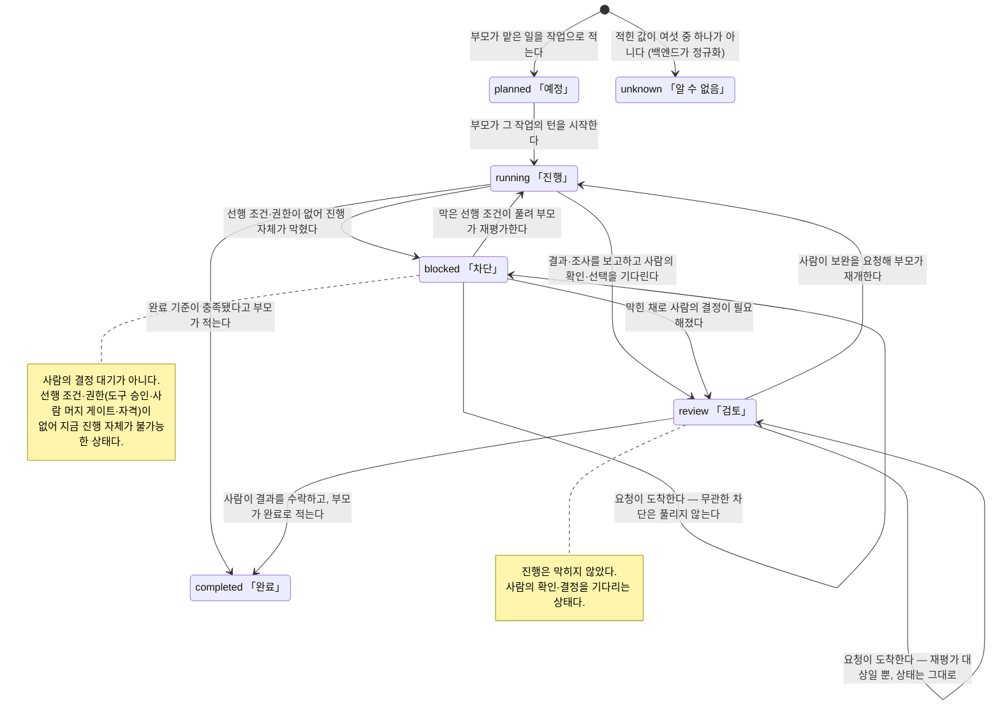
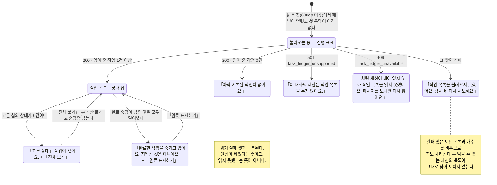

# 테스트 문서: AI 채팅 — 작업 원장의 상태

## 검증 대상 AC
- AC10: 작업 패널 — 보는 방식과, 원장에 남기는 요청 (PRD-1: `prd-ai-chat.md`)
  — 이 문서는 AC10 중 **작업 원장의 상태와 그 표시**만 다룬다. 같은 AC의 선택지(원장이 쓴 문장)·작업 이력(턴)·요청
  저장의 세부는 아직 시나리오가 없다(기존 공백 — 아래 「이 문서가 다루지 않는 것」).

## 달성 가치
- V9: 개발 워크플로우 인지 부하 감소 (「파악」) — 맡긴 일이 지금 어디에 서 있는지를 대화를 되짚지 않고 본다.
- V5: 자연어 대화 기반 작업 처리 — 패널은 그 대화를 맡은 세션의 작업을 보여 주는 자리다.

## 작성 기준
- 시나리오는 **사용자가 관찰할 수 있는 결과** 단위로 쓴다. 코드 레벨 테스트는 각 시나리오의
  「관련 코드 테스트」에 참고로만 적으며, 시나리오의 검증을 대신하지 않는다.
- 「구현 상태」는 작성 시점(2026-11-28, main `ca0e9ea`) 코드를 **읽어** 적었다. 앱이나 운영 원장에서 전이를 실행해
  확인한 것이 아니다 — 실행으로 확인한 범위는 「관련 코드 테스트」가 가리키는 자동 테스트까지다.
- 작업 패널은 **안드로이드에만 있다**. iOS(`ios/PocketAide/`)에는 패널 구현이 없으므로 이 문서의 화면 시나리오는
  안드로이드에서 관찰한다. 백엔드 경로(`GET /api/chat/tasks`)는 두 앱과 무관하게 돌아간다.
  아래에서 파일명만 적은 안드로이드 코드(`ChatTasks.kt`·`ChatTaskPanel.kt`·`ChatTaskDetail.kt`·`ChatViewModel.kt`)는
  모두 `android/app/src/main/java/com/dlddu/pocketaide/chat/` 아래에 있다.
- **상태 값과 라벨은 실제 값이다** — `planned`·`running`·`blocked`·`review`·`completed`·`unknown` 과 「예정」·「진행」·
  「차단」·「검토」·「완료」·「알 수 없음」, 그리고 「…」로 인용한 화면 문구는 코드·계약에서 그대로 옮긴 것이다.
  반면 작업 제목·ID(`예시-1` …)와 건수는 시나리오를 돌리기 위한 **fixture** 이고 제품의 값이 아니다.
- 원장은 pocket-aide 의 DB에 없다. 이 대화를 맡은 `dlddu/session-platform` 세션의 슬롯 SQLite(`sp_work_tasks`·`sp_work_turns`)에
  있고, 백엔드는 읽기 전용 work 경로로 그것을 **읽기만** 한다. 그래서 사전 조건의 「원장에 … 작업이 있다」는 부모 세션이
  이미 적어 둔 상태를 뜻하며, 테스트하는 사람이 앱에서 만들 수 있는 것이 아니다.
- 시나리오 번호는 식별자(`test-ai-chat.md#시나리오 N`)의 일부다. 중간 삽입하지 말고 끝에 덧붙인다.
- 시나리오 ↔ 안드로이드 계측 테스트 대응(매칭·예외·구현 대기·공백)은 이 문서가 아니라
  `doc-tracker/` 최신 월 파일의 「e2e 매핑」 절에서 판정한다.

## 작업 원장의 상태 계약

### 상태 값과 라벨

| 값 | 패널 라벨 | 뜻 | 근거 |
|---|---|---|---|
| `planned` | 「예정」 | 맡기로 적혔고 아직 턴이 시작되지 않았다 | `backend/internal/chat/tasks.go` `TaskStatusPlanned` · `dlddu/session-platform` `docs/session-ledger.md` 「The agreed shape」 |
| `running` | 「진행」 | 부모가 그 작업을 진행하고 있다 | 같은 곳 |
| `blocked` | 「차단」 | **진행 자체가 막혔다** — 선행 조건·권한이 없다 | 같은 곳 · AC10(차단 칩) |
| `review` | 「검토」 | **사람의 확인·결정을 기다린다** | 같은 곳 · AC10(검토 칩) |
| `completed` | 「완료」 | 부모가 완료로 적었다 | 같은 곳 |
| `unknown` | 「알 수 없음」 | 상태를 알 수 없다 | 같은 곳 — 아래 「`unknown` 이 생기는 세 가지 길」 |

표시 순서는 `blocked` → `review` → `running` → `planned` → `completed` → `unknown` 이다 — 사람이 손대야 하는 것이
먼저, 그다음 기다리는 것, 끝으로 끝난 것이다(`taskStatuses` / `ChatTaskStatus.order`). 이것은 **칩의 순서**이고
작업 줄의 순서가 아니다. 줄은 원장이 준 순서 그대로 그려진다.

`blocked` 와 `review` 둘만 「손댈 것」으로 센다(`needsAttention`) — 칩과 배지가 영역 강조색을 쓰고, 그 작업 줄은
「묻는 것」·「완료 기준」을 적힌 대로(없으면 「미기록」) 함께 보인다.

### `unknown` 이 생기는 세 가지 길

1. **정규화** — 백엔드가 플랫폼이 적은 값을 소문자로 바꾸고 공백을 떼어 여섯 값과 맞춰 보고, 어느 것도 아니면
   `unknown` 으로 돌린다(`normaliseStatus`). 그래서 `BLOCKED`·` review ` 는 `blocked`·`review` 로 읽히고,
   `deploying`·빈 문자열은 `unknown` 이 된다. 원문 값은 화면에 나오지 않는다 — 추측하지 않고 「알 수 없음」이라고만 말한다.
2. **플랫폼이 직접 적은 값** — `unknown` 은 정규화의 쓰레기통이기만 한 것이 아니라 **상태 도메인의 값**이다
   (플랫폼 `docs/session-ledger.md` · `docs/prd/agent-auth-pool.md` AC-N10 — 「상태 영역은 원장의 것을 그대로 쓴다」).
3. **이력 반입** — 상위 원장 계약은 뒤늦게 반입한 이력을 `unknown` 으로 시작하게 하고 `running` 으로 들이지 않는다
   (플랫폼 `docs/session-ledger.md`). 이 레포는 그 반입을 하지 않으므로, 패널에서는 2·3이 구분되지 않는다.

`unknown` 은 「손댈 것」이 아니고 `completed` 도 아니므로, 강조색이 붙지 않고 「완료 숨기기」로 덜어내지지도 않는다.

### 이 레포가 강제하는 것과, 강제하지 않는 것

| | 누가 정하나 | 이 레포에서 테스트할 수 있나 |
|---|---|---|
| 상태 **값의 집합**(여섯 개)과 그 밖의 값이 `unknown` 이 되는 것 | 플랫폼 계약 + 백엔드 `normaliseStatus` | **그렇다** — 시나리오 2 |
| 그 값이 패널에서 어떤 라벨·순서·강조로 보이는지 | 이 레포(안드로이드 `ChatTasks.kt`·`ChatTaskPanel.kt`) | **그렇다** — 시나리오 1·5 |
| 보는 방식(칩·완료 숨김)이 원장을 바꾸지 않는 것 | 이 레포(`ChatTaskFilter`) | **그렇다** — 시나리오 3·4 |
| 읽을 수 없는 원장이 「작업 없음」으로 보이지 않는 것 | 백엔드 상태 코드 + 앱의 분기 | **그렇다** — 시나리오 6 |
| **상태가 어떤 상태로 옮겨 가는지(전이)** | 부모 세션이 자기 원장에 적는다 | **아니다** — 아래 주의 |

> **전이는 스키마가 강제하지 않는다.** pocket-aide 는 상태를 **읽기만** 한다 —
> `GET /api/chat/tasks` 는 쓰지도 복원하지도 삭제하지도 않고(`backend/internal/handlers/chat_tasks.go`),
> 이 레포의 마이그레이션에는 작업 테이블이 아예 없다. 상위 계약(플랫폼 `docs/session-ledger.md`)도 상태의 **값 집합**은
> 고정하지만(이름을 바꾸면 사람이 이미 「막혔다」·「끝났다」로 본 작업이 움직인다) 어떤 전이가 허용되는지를 정하지
> 않으며, 「API 는 실제 소유·완료·보존·삭제의 증거를 검증하지 않는다」고 적어 둔다. 따라서 아래 다이어그램의 화살표는
> **강제되는 그래프가 아니라 부모가 운영하면서 쓰는 대표 경로**다. 테스트는 「이 전이가 막히는지」가 아니라
> 「적힌 상태가 화면에 그대로 보이는지」를 본다.

### 상태 다이어그램 (대표 운영 전이)

### 전이별 근거

| 전이 | 무엇이 그렇게 만드나 | 근거의 종류 |
|---|---|---|
| `planned` → `running` | 부모가 그 작업의 턴을 시작한다 | 운영 관례 (계약에 전이 규칙 없음) |
| `running` → `review` | 부모가 결과·조사를 보고하고 사람의 확인·후속 선택을 기다린다 | 운영 관례 · AC10(검토 칩 · 「묻는 것」) |
| `running` → `blocked` | 선행 조건·권한이 없다. 선택지는 「보낼 문장이고 권한이 아니다 — 호출별 도구 승인·사람 머지 게이트를 대신하지 않는다」(AC10) | 운영 관례 + AC10의 제약 |
| `review` → `completed` | 사람이 결과를 수락하고 **부모가** 완료로 적는다 | 운영 관례 — 앱에는 상태를 바꾸는 버튼이 없다 |
| `review` → `running` | 사람이 보완을 요청하고 부모가 그 요청을 접수해 재개한다 | 운영 관례 + 아래 계약 |
| `blocked` → `running` / `review` | 부모가 재평가한다 | 운영 관례 |
| `review` → `review`, `blocked` → `blocked` (요청 도착) | 「요청이 왔다는 것만으로 작업 상태·승인이 바뀌거나 무관한 차단이 풀리지는 않는다」. 다만 새 사용자 입력이므로 `blocked`·`review` 작업은 **재평가 대상**이다 | **계약** — AC10 · 플랫폼 `docs/prd/agent-auth-pool.md` AC-N7 · `docs/session-ledger.md` 「Discovery, and the parent's order of work」 4단계 |
| `*` → `unknown` | 여섯 중 하나가 아닌 값 | **계약 + 코드** — `normaliseStatus` |

### 계약에 적혀 있지 않은 것 (지어내지 않는다)

- **`completed` 에서 되돌아가는 전이.** 계약이 재평가 대상으로 이름 붙인 것은 `blocked`·`review` 뿐이다. 완료된 작업에
  요청을 남겼을 때 부모가 상태를 되돌리는지는 적혀 있지 않다 — 그렇게 동작한다고 기대하는 시나리오를 두지 않았다.
- **취소.** `cancelled` 같은 값은 현재 상태 도메인에 없다. 그런 값이 원장에 적히면 패널은 「알 수 없음」으로 보인다
  (시나리오 2). 작성 시점에 취소 상태를 더하는 변경이 PR #424 로 **열려 있고 머지되지 않았다** — 이 문서는 그것을
  현재 제품 동작으로 적지 않는다.
- **단계(stage)·사유·다음 행동.** 옛 원장(`sp_ledger_tasks`)의 칸이고 **부모의 장부**다. 지금 패널이 읽는
  `sp_work_tasks` 에는 그 칸이 없어, 화면은 대신 작업의 `description`·`completion_criteria` 와 열린 턴의 `question`
  을 보인다(`backend/internal/chat/tasks.go` 머리 주석). AC10 본문은 아직 「상태·단계·사유·다음 행동」이라고 적고
  있어 코드와 어긋난다 — 제품 결정이므로 이 문서에서 고치지 않고 차이만 남긴다.
- **턴의 상태.** 턴에는 `requested_at`·`started_at`·`ended_at` 이 있고 백엔드는 「끝나지 않은 최신 턴」을 `waiting`
  으로, 「부모가 집은 턴」을 `waiting.running` 으로 보낸다. 이것은 **턴의 사실이고 작업 상태 enum 이 아니다** —
  작업이 `review` 인지 `blocked` 인지와 따로 움직인다.
- **세션의 상태.** 세션이 떠 있는지·스냅샷인지, 모니터 레인이 돌고 있는지는 세션의 수명주기이고(`test-session-platform.md`)
  작업 상태가 아니다. 패널에서는 「읽을 수 없는 원장」(시나리오 6)으로만 드러난다.

## 패널이 그 상태를 읽어 그리는 화면 상태

아래는 **화면**의 상태다. 작업 원장의 상태가 아니고, 폴링마다 처음부터 다시 판정된다.

판정 순서는 **불러오는 중 → 읽기 실패 → 빈 목록(세 가지) → 목록**이다(`ChatTaskPanel.kt`). 빈 목록 셋 중에서는
「원장에 작업이 없음」이 먼저다 — 칩을 골라 둔 채 원장이 비면 「아직 기록된 작업이 없어요.」가 보이고, 되돌릴 칩을
권하지 않는다(되돌려도 보여 줄 것이 없다).

## 이 문서가 다루지 않는 것

AC10 의 나머지 — 세션이 쓴 **선택지**(`stale_choice` 거부·초안 출처), 작업 **이력**(턴 펼침·조회 0건 규칙),
**요청 저장**(`POST /api/chat/tasks/{작업}/requests`·요청 번호 재전송)·상세 칸의 세부 — 는 아직 시나리오가 없다.
요청을 남기는 흐름의 사용자 관점은 `user-journeys/JRN-chat-task-request.md` 에 있고, 상태가 요청으로 바뀌지
않는다는 것만 이 문서의 시나리오 7 이 잡는다.

## 테스트 시나리오

### 시나리오 1: 패널은 원장의 상태를 칩과 개수로 요약하고, 손댈 것을 먼저 보인다
- **사전 조건**: 사용자 A로 로그인. 넓은 창(600dp 이상). 이 대화를 맡은 세션의 원장에 작업 11건이 있다 —
  `blocked` 1(`예시-차단`), `review` 2, `running` 1, `planned` 3, `completed` 4. 원장이 주는 작업 순서는
  `예시-차단` 이 맨 앞이 아니다(fixture: 완료 작업 하나를 첫 줄로 둔다).
- **실행 단계**:
  1. 채팅 탭을 넓은 창에서 연다.
  2. 패널 헤더의 칩 줄을 본다.
  3. 작업 줄의 순서와 각 줄의 상태 배지를 본다.
  4. 좁은 창으로 줄이거나 창을 분할한다.
- **기대 결과**:
  - 2단계: 「전체 11」 다음에 「차단 1」·「검토 2」·「진행 1」·「예정 3」·「완료 4」가 **그 순서로** 보인다.
    0건인 상태(`unknown`)의 칩은 없다. 「차단」·「검토」만 영역 강조색이고 나머지는 흐린 잉크색이다.
  - 3단계: 줄 순서는 **원장이 준 순서 그대로**다 — 칩 순서로 다시 정렬되지 않아 완료 작업이 첫 줄에 남는다.
    각 줄의 배지 글자는 칩과 같은 라벨이다.
  - 4단계: 패널이 사라지고 대화만 남는다(기기·방향이 아니라 창의 가로폭으로 결정된다).
- **검증 AC**: AC10
- **구현 상태**: 구현됨(안드로이드만) — 백엔드가 플랫폼 work 경로를 끝까지 걸어 작업과 `counts` 를 만들고
  (`backend/internal/chat/tasks.go`), 안드로이드가 `ChatTaskStatus.order` 로 칩을, 원장 순서로 줄을 그린다.
  칩은 `counts` 가 0 이 아닌 상태(또는 고른 상태)만 나온다. iOS 에는 패널이 없다.
- **관련 코드 테스트**: `android/app/src/test/java/com/dlddu/pocketaide/chat/ChatTasksTest.kt` —
  `displayOrderPutsAttentionFirst`·`loadShowsTheLedgerWithStatusStageAndNote`·`wideLayoutStartsAtTheBreakpoint`,
  `android/app/src/androidTest/java/com/dlddu/pocketaide/chat/ChatTaskPanelLayoutTest.kt`,
  `backend/internal/chat/tasks_test.go` — `TestTasks_CarryTheAgreedModelAndWalkEveryPage`

### 시나리오 2: 여섯 중 하나가 아닌 상태는 「알 수 없음」으로 보이고, 추측되지 않는다
- **사전 조건**: 원장에 작업 네 건이 있고 `status` 가 각각 `BLOCKED`(대문자)·` review `(앞뒤 공백)·`deploying`·
  빈 문자열이다(fixture — 플랫폼이 쓸 수 있는 모양을 흉내 낸 값이다).
- **실행 단계**:
  1. 패널을 연다.
  2. 네 줄의 상태 배지를 본다.
  3. 칩 줄과 개수를 본다.
  4. 「완료 숨기기」를 켠다.
- **기대 결과**:
  - 2단계: `BLOCKED` 는 「차단」, ` review ` 는 「검토」로 보인다(소문자·공백 제거 뒤 일치). `deploying` 과
    빈 문자열은 둘 다 「알 수 없음」이다.
  - 3단계: 「차단 1」·「검토 1」·「알 수 없음 2」가 보인다. 「알 수 없음」 칩은 강조색이 아니다.
    원문 값(`deploying`)·빈 문자열 자리가 화면 어디에도 나오지 않는다.
  - 4단계: 「알 수 없음」 두 줄은 그대로 남는다(완료가 아니다).
- **검증 AC**: AC10
- **구현 상태**: 구현됨 — `normaliseStatus` 가 소문자·트림 후 여섯 값과 맞춰 보고 아니면 `unknown` 을 돌려주며
  (`backend/internal/chat/tasks.go`), 앱의 `ChatTaskStatus.label` 은 아는 다섯 값만 번역하고 나머지를
  「알 수 없음」으로 적는다. `unknown` 은 `needsAttention` 이 아니고 숨김 대상도 아니다.
- **관련 코드 테스트**: `backend/internal/chat/tasks_test.go` — `TestTasks_UnknownStatusIsNotGuessed`,
  `android/app/src/test/java/com/dlddu/pocketaide/chat/ChatTasksTest.kt` — `anUnknownStatusIsLabelledNotGuessed`

### 시나리오 3: 칩과 완료 숨김은 함께 걸리고, 원장을 바꾸지 않는다
- **사전 조건**: 원장에 `review` 2건·`completed` 3건·`planned` 1건이 있다.
- **실행 단계**:
  1. 「검토」 칩을 누른다.
  2. 그 상태에서 「완료 숨기기」를 켠다.
  3. 「검토」 칩을 다시 누른다.
  4. 「완료」 칩을 누른다.
  5. 패널을 접었다 펴고, 다시 조회가 돌 때까지 기다린다.
- **기대 결과**:
  - 1단계: 검토 2줄만 남는다. 칩 개수는 **그대로**다(「완료 3」이 1로 줄지 않는다 — 개수는 읽어 온 원장 전체 기준).
  - 2단계: 검토는 완료가 아니므로 숨김이 덜어낼 것이 없다 — 여전히 검토 2줄이다.
  - 3단계: 전체로 돌아가되 **숨김은 남는다** — 완료 3줄을 뺀 3줄(검토 2 + 예정 1)이 보인다.
  - 4단계: 「완료」 칩과 숨김이 동시에 걸려 보여 줄 줄이 없다 — 「완료한 작업을 숨기고 있어요. 지워진 것은
    아니에요.」와 「완료 표시하기」가 보인다 — 고른 상태가 비었다는 문구(시나리오 4의 2단계)가 아니다.
    완료 작업은 원장에 있고, 숨김이 덜어낸 것이다.
  - 5단계: 고른 칩·숨김이 유지된다. 어느 단계에서도 원장에 쓰기가 가지 않고, 다시 조회해도 개수·상태가 같다.
- **검증 AC**: AC10
- **구현 상태**: 구현됨 — `ChatTaskFilter` 는 그릴 줄만 고르는 값이고 서버를 부르지 않는다. 칩은 고른 것을
  다시 누르면 `전체` 로 풀리며(`toggled`) 숨김은 따로 남는다. 「완료 숨기기」 토글은 완료가 1건 이상이거나
  숨김이 켜져 있을 때 보인다(보이지 않는 선택은 되돌릴 수 없으므로).
- **관련 코드 테스트**: `android/app/src/test/java/com/dlddu/pocketaide/chat/ChatTaskRequestTest.kt`(칩 + 숨김 교집합),
  `android/app/src/androidTest/java/com/dlddu/pocketaide/chat/ChatTaskPanelInteractionTest.kt`

### 시나리오 4: 빈 목록 세 가지를 서로 다른 말로 구분한다
- **사전 조건**: 네 가지 원장을 차례로 쓴다 — (가) 작업 0건, (나) `planned` 2건만, (다) `completed` 2건만,
  (라) 작업 0건.
- **실행 단계**:
  1. (가) 패널을 연다.
  2. (나) 「예정」 칩을 누른 뒤, 「검토」 칩으로 바꿔 누른다.
  3. (다) 「완료 숨기기」를 켠다.
  4. (라) 「예정」 칩을 누른 상태로 패널을 다시 읽는다.
- **기대 결과**:
  - 1단계: 「아직 기록된 작업이 없어요.」만 보인다. 되돌릴 칩이 함께 보이지 않는다.
  - 2단계: 「검토」를 고르면 「「검토」 작업이 없어요.」와 「전체 보기」가 보인다. 「전체 보기」를 누르면
    예정 2줄이 돌아온다.
  - 3단계: 「완료한 작업을 숨기고 있어요. 지워진 것은 아니에요.」와 「완료 표시하기」가 보인다.
    「아직 기록된 작업이 없어요.」가 아니다 — 작업은 원장에 있다.
  - 4단계: 칩을 골라 두었어도 「아직 기록된 작업이 없어요.」가 보인다(원장이 비었다는 사실이 먼저다).
- **검증 AC**: AC10
- **구현 상태**: 구현됨 — `ChatTaskFilter.emptiness` 가 「원장이 비었다」 → 「고른 상태가 없다」 →
  「숨김이 덜어냈다」 순으로 판정하고, 뒤 둘은 한 번에 되돌릴 칩을 함께 둔다.
- **관련 코드 테스트**: `android/app/src/test/java/com/dlddu/pocketaide/chat/ChatTasksTest.kt` —
  `anEmptyLedgerIsTheEmptyState`, `android/app/src/test/java/com/dlddu/pocketaide/chat/ChatTaskRequestTest.kt`,
  `android/app/src/androidTest/java/com/dlddu/pocketaide/chat/ChatTaskPanelInteractionTest.kt`,
  `backend/internal/chat/tasks_test.go` — `TestTasks_NoSessionYetIsAnEmptyList`

### 시나리오 5: 차단과 검토는 다른 뜻이고, 적혀 있지 않은 칸은 「미기록」이라고 말한다
- **사전 조건**: 원장에 세 작업이 있다 — `예시-차단`(`blocked`, 열린 턴의 `question` 없음, `completion_criteria`
  적혀 있음), `예시-검토`(`review`, `question` 적혀 있음), `예시-예정`(`planned`, `question`·`completion_criteria`
  둘 다 없음).
- **실행 단계**:
  1. 패널을 연다.
  2. 세 줄을 차례로 본다.
- **기대 결과**:
  - `예시-차단`: 배지 「차단」(강조색). 「묻는 것 · 미기록」과 「완료 기준 · (적힌 값)」이 보인다 —
    빈칸으로 두지도, 사유를 지어내지도 않는다.
  - `예시-검토`: 배지 「검토」(강조색). 「묻는 것 · (적힌 질문)」이 보인다. 이 줄이 기다리는 것은 **사람의 결정**이고,
    차단처럼 진행이 막힌 것이 아니다 — 화면이 그 차이를 말하는 수단은 상태 라벨이다.
  - `예시-예정`: 배지 「예정」(흐린 색). 「묻는 것」·「완료 기준」 줄이 **아예 보이지 않는다**(손댈 상태가 아니고
    적힌 것도 없으므로).
- **검증 AC**: AC10
- **구현 상태**: 구현됨 — 두 줄(`묻는 것`·`완료 기준`)은 상태가 `blocked`·`review` 이거나 둘 중 하나가 적혀 있을
  때만 그려지고, 값이 비면 「미기록」을 붙여 흐리게 보인다(`ChatTaskPanel.kt` `Note`). 「묻는 것」은 열린 턴
  (`waiting.question`)에서, 「완료 기준」은 작업의 `completion_criteria` 에서 온다.
- **관련 코드 테스트**: `android/app/src/test/java/com/dlddu/pocketaide/chat/ChatTasksTest.kt` —
  `loadShowsTheLedgerWithStatusStageAndNote`, `backend/internal/chat/tasks_test.go` —
  `TestTasks_WaitingComesFromTheLatestTurn`

### 시나리오 6: 읽을 수 없는 원장은 「작업이 없다」가 아니다
- **사전 조건**: 넓은 창에서 패널을 연다. 네 상황을 차례로 만든다 — (가) 첫 응답이 아직 오지 않음,
  (나) 작업 기록을 두지 않는 세션(백엔드 501), (다) 세션이 깨어 있지 않음(409), (라) 서버 오류·네트워크 실패.
  (다)에 들어가기 전 화면에는 작업 3건이 보이고 있다.
- **실행 단계**:
  1. (가) 패널 본문을 본다.
  2. (나) 패널 본문을 본다.
  3. (다) 패널 본문과 칩 줄을 본다.
  4. (라) 패널 본문을 본다.
  5. 각 상황에서 플랫폼 쪽 세션이 깨어났는지 확인한다.
- **기대 결과**:
  - 1단계: 진행 표시만 보인다. 「아직 기록된 작업이 없어요.」가 아니다.
  - 2단계: 「이 대화의 세션은 작업 목록을 두지 않아요.」
  - 3단계: 「채팅 세션이 깨어 있지 않아 작업 목록을 읽지 못했어요. 메시지를 보내면 다시 읽어요.」
    앞서 보이던 3건과 칩이 **사라진다** — 읽을 수 없는 세션의 목록을 현재처럼 남겨 두지 않는다.
  - 4단계: 「작업 목록을 불러오지 못했어요. 잠시 뒤 다시 시도해요.」(실패색). 내부 주소·상류 오류 원문이 없다.
  - 5단계: 어느 단계에서도 목록을 읽는 것이 세션을 깨우지 않는다.
  - 네 상황 모두에서 「아직 기록된 작업이 없어요.」가 보이지 않는다.
- **검증 AC**: AC10
- **구현 상태**: 구현됨 — 백엔드가 플랫폼의 501·404 를 `task_ledger_unsupported`(501), 409 를
  `task_ledger_unavailable`(409)로 구분해 돌려주고 어느 쪽도 빈 목록으로 바꾸지 않는다
  (`backend/internal/chat/tasks.go`·`backend/internal/handlers/chat_tasks.go`). 앱은 501·409·그 밖을 세 문구로
  나누고, 실패하면 목록·개수·잘림 표시를 비운다(`ChatViewModel`).
- **관련 코드 테스트**: `backend/internal/chat/tasks_test.go` —
  `TestTasks_UnsupportedAndUnavailableAreNotEmptyLists`·`TestTasks_PlatformFaultIsAnError`,
  `android/app/src/test/java/com/dlddu/pocketaide/chat/ChatTasksTest.kt` —
  `unreadableLedgersAreTheirOwnStatesAndClearTheList`·`beforeTheFirstAnswerThePanelIsLoadingNotEmpty`

### 시나리오 7: 요청을 남겨도 상태는 부모가 적을 때만 움직인다
- **사전 조건**: 원장에 `예시-차단`(`blocked`)이 있고 칩은 「차단 1」이다. 부모 세션은 깨어 있다.
- **실행 단계**:
  1. `예시-차단` 으로 들어가 요청을 쓰고 「요청 등록」을 누른다.
  2. 저장 직후 상세의 상태 배지와, 목록으로 돌아가 칩 개수를 본다.
  3. 대화 쪽을 본다.
  4. 부모가 그 요청을 접수해 재평가하고 원장에 `running` 으로 적을 때까지 기다린 뒤, 다음 조회를 본다.
  5. 같은 작업과 **무관한** 다른 `blocked` 작업의 상태를 본다.
- **기대 결과**:
  - 1~2단계: 「요청 저장됨 · 부모 확인 대기」로 말한다(「처리됨」이 아니다). 배지는 여전히 「차단」이고
    칩도 「차단 1」 그대로다 — 요청 저장이 상태를 바꾸지 않는다.
  - 3단계: 대화에 아무 메시지도 올라가지 않는다.
  - 4단계: 배지가 「진행」으로, 칩이 「차단 0건(칩 사라짐)·진행 1」로 바뀐다. 바꾼 주체는 부모의 기록이고
    앱의 버튼이 아니다 — 패널에는 상태를 바꾸는 버튼이 없다.
  - 5단계: 그 작업은 `blocked` 그대로다. 요청이 왔다는 것만으로 무관한 차단이 풀리지 않는다.
- **검증 AC**: AC10
- **구현 상태**: 부분 구현 — 요청 저장과 「요청 저장됨 · 부모 확인 대기」 문구, 상세가 상태 배지를 그리는 것
  (`ChatTaskDetail.kt`, 목록과 같은 `StatusBadge`), 상태를 읽기만 하는 패널은 구현됐다
  (`POST /api/chat/tasks/{작업}/requests`·`backend/internal/chat/task_requests.go`). 4단계의 상태 변화는
  **부모 세션의 기록**이라 이 레포에서 만들 수 없고, 관측은 다음 조회가 가져오는 값으로만 한다.
  「요청이 와도 상태·승인이 바뀌지 않는다」는 계약 쪽 보장이다(플랫폼 AC-N7).
- **관련 코드 테스트**: `android/app/src/test/java/com/dlddu/pocketaide/chat/ChatTaskRequestTest.kt`,
  `backend/internal/handlers/chat_tasks_test.go`, `backend/internal/chat/task_requests_test.go`

### 시나리오 8: 다 읽지 못한 원장은 「일부만」이라고 말한다
- **사전 조건**: 원장의 작업이 백엔드가 한 번에 걷는 한도를 넘는다(한 페이지 100건 · 최대 50페이지).
  또는 플랫폼이 움직이지 않는 커서를 돌려준다.
- **실행 단계**:
  1. 패널을 연다.
  2. 칩 줄 아래를 본다.
  3. 칩의 개수와 보이는 줄 수를 대조한다.
- **기대 결과**:
  - 2단계: 「작업이 많아 일부만 보여요.」가 보인다 — 앞부분만 읽은 목록이 원장 전체처럼 읽히지 않는다.
  - 3단계: 칩의 개수는 **읽어 온 작업**의 집계이므로, 잘린 상태에서는 원장 전체의 수보다 적을 수 있다.
    「전체」 칩의 수와 상태 칩들의 합은 서로 같다.
- **검증 AC**: AC10
- **구현 상태**: 구현됨 — 페이지 한도에 닿거나 커서가 움직이지 않으면 `truncated` 를 세워 보내고
  (`backend/internal/chat/tasks.go` `workMaxPages`), 패널이 그 문구를 띄운다. 개수는 걸어서 읽은 작업만 센다.
- **관련 코드 테스트**: `backend/internal/chat/tasks_test.go` — `TestTasks_UnfinishedWalkIsReportedTruncated`,
  `android/app/src/test/java/com/dlddu/pocketaide/chat/ChatTasksTest.kt` — `aTruncatedWalkIsCarriedToThePanel`
