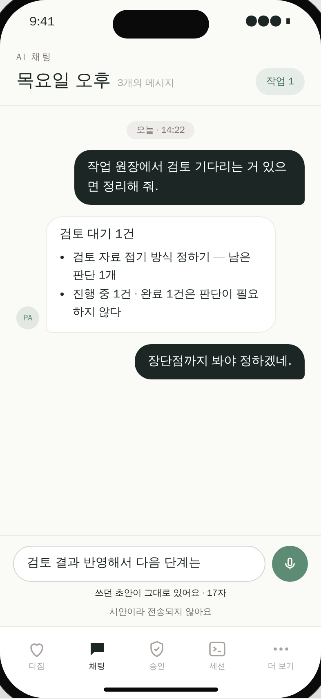
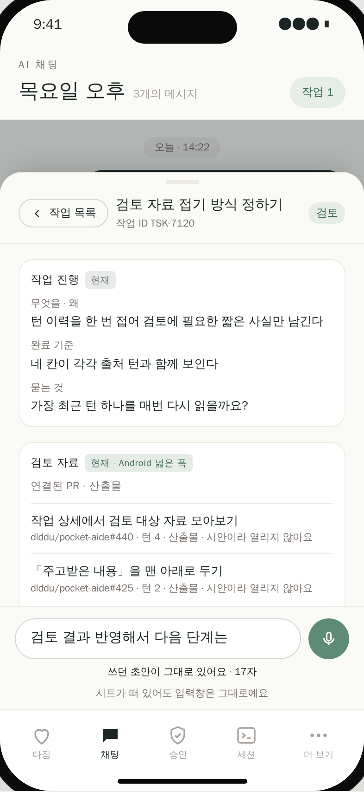
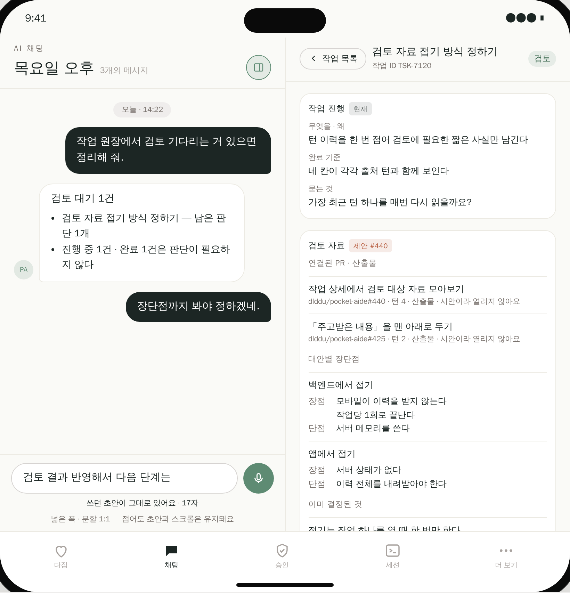
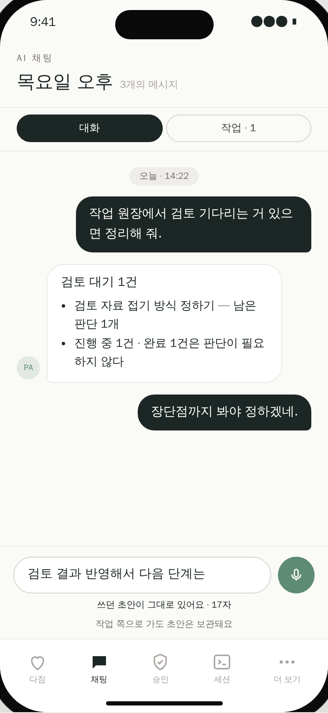
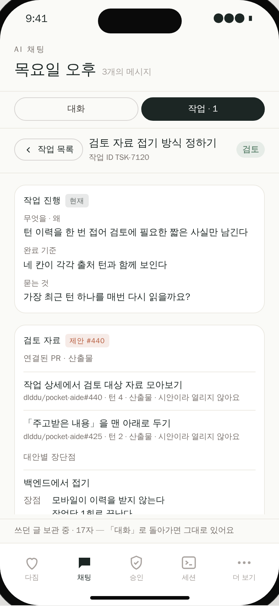
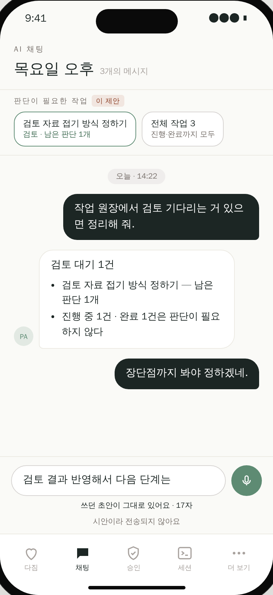
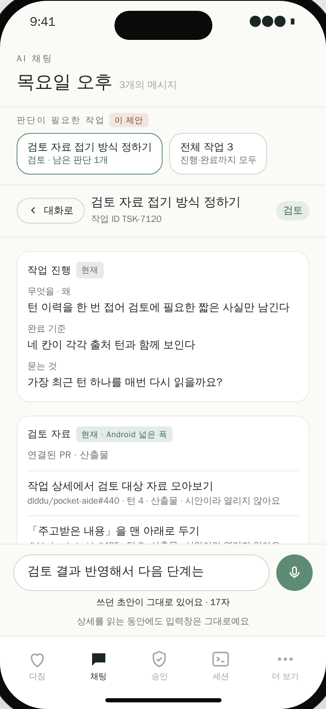

# 채팅 탭 화면 구조 — 디자인 제안 3안 비교 (시안)

> **시안이다.** 가상 데이터이고, 공식 목업(`docs/mockups/`)·제품 문서를 대체하지 않는다.
> 채택 여부는 사용자 검토에 남긴다. 이 문서와 시안은 어떤 서버도 호출하지 않는다.

**눌러 볼 수 있는 비교 페이지**: [`index.html`](./index.html) — 한 진입점에서 3안 × (기본 / 확장 좁은 폭 / 확장 넓은 폭) 9가지를 전환하며 각 경로를 실제로 조작할 수 있다.
외부 스크립트·폰트·네트워크 요청이 0건인 단일 정적 파일이라 내려받아 열면 그대로 뜬다.
(GitHub 의 HTML blob 은 원문만 보여 주므로, 아래 렌더 이미지가 브라우저에서 실제로 그려진 모습이다.)

---

## 왜 이 제안인가 — 현재 구현에서 실측한 빈칸

| 사실 | 출처 |
|---|---|
| **작업 원장은 넓은 폭 전용이다.** 좁은 폭에는 패널도, 그것을 여는 토글도 그려지지 않는다 | `android/app/src/main/java/com/dlddu/pocketaide/chat/ChatScreen.kt:336-337, 357-359, 450-452` |
| 분기는 기기가 아니라 **창의 가용 폭 600dp** 로 한 번 판단한다 | `docs/design-system/tokens.md` §6.1 |
| 넓은 폭은 1:1 분할 + 1dp rule, 좁은 폭에서는 보조 창을 **아예 올리지 않는다** | `docs/design-system/tokens.md` §6.2 |
| 패널이 화면에 없으면 폴링도 돌지 않는다 | `ChatScreen.kt:342-344` |
| 상세는 같은 오른쪽 창에서 한 단계 들어가고, 뒤로는 목록으로 돌아온다(탭을 떠나지 않는다) | `ChatScreen.kt:363-394` |
| 초안·패널 열림 여부·스크롤 자리는 접기/펴기와 상세 왕복을 견딘다 | `ChatScreen.kt:113-123, 148` · `ChatTaskPanel.kt:63-65` |
| 상세 필드는 「무엇을 · 왜」 「완료 기준」 「묻는 것」 「선택지」 「이 작업에 보낼 요청」 | `ChatTaskDetail.kt:136-137, 154, 320, 324` |
| 요청·선택지는 **대화로 보내지 않는다** — 원장에만 남는다 | `ChatTaskDetail.kt:471` |
| **iOS 에는 작업 패널도 분할도 없다** | `ios/` 에 `ChatTaskPanel`·`isWideChatWindow` 해당 코드 없음 |

**즉, 좁은 폭(= 접힌 폰의 기본 상태)에서는 작업 원장에 닿을 길이 아예 없다.** 세 안은 모두 이 빈칸을 서로 다른 방식으로 메운다.

### 하단 탭 — 문서와 구현이 어긋나 있다

구현 실측은 **다짐 · 채팅 · 승인 · 세션 · 더 보기**(채팅이 둘째 칸)다
— `android/.../ui/RootTab.kt:37`, `ios/PocketAide/RootView.swift:116-149`.
`tokens.md` §7 과 `docs/mockups/screen-chat-text.html` 은 아직 「채팅은 더 보기 안」이라고 말한다.
이 어긋남은 **열린 PR #438** 이 문서를 구현에 맞추는 방향으로 정리 중이다.
이 시안의 탭 바는 **구현 실측**을 그렸다.

### 현재 / 제안 구분

| 표시 | 뜻 |
|---|---|
| `현재` | `main` 에 구현돼 있다 |
| `제안 #440` | **열린 PR #440**(`7e4161d`)의 계약 — 「검토 자료」 네 칸. 아직 병합 전이다 |

같이 대조한 것: **#425**(머지됨 — 「주고받은 내용」을 맨 아래 접어 두고 펼칠 때만 읽는다),
**#439**(열림 `b6af434` — 채팅 헤더에서 세션 아카이브 + 확인창),
**#411**(열림 — 읽던 자리 복원·「맨 아래로」),
**#438**(열림 — 탭 순서), **#428**(열림 — 말풍선 시각 처리).
**#442**(열림 `3b668a3` — 쓰다 만 초안이 탭을 옮겨도 남는다, AC11 신설).
`#439`·`#411`·`#428` 은 이 시안이 건드리지 않는 영역이라 그대로 두었다. `#442` 와의 관계는 아래 「초안 복원」 절에 적었다.

---

## 세 안 한 줄 차이

| | 원장에 어떻게 들어가나 | 좁은 폭에서 동시에 보이는 것 | 넓은 폭(820dp)의 분할 | 초안으로 어떻게 돌아오나 |
|---|---|---|---|---|
| **A · 대화 중심 + 원장 시트** | 헤더 「작업 N」 칩 → 대화 위로 시트가 올라온다 | 대화 일부 + **입력창** + 원장 | 대화 \| 원장(목록→상세 한 단계) — **현재 구현과 같은 모습** | 시트를 닫으면 끝. 초안은 내내 **보인다** |
| **B · 원장 중심 목록/상세** | 세그먼트 「대화 \| 작업」으로 화면을 통째로 바꾼다 | 원장 **하나만** (전체 폭) | 「작업」 모드면 **목록 \| 상세**가 분할을 다 쓰고 대화는 물러난다 | 「대화」 세그먼트로 복귀. 초안은 보관되지만 **안 보인다** |
| **C · 초안 고정 + 작업 레일** | 대화 위 레일의 칩 → 목록을 건너뛰고 **상세로 바로** | 상세 + **입력창**(붙박이) | 대화+입력창 \| 레일+**상세 바로**(목록 단계 없음) | 「대화로」 **1탭**. 입력창은 한 번도 안 사라진다 |

세 안은 넓은 폭에서도 갈라진다. A 만 §6.2 의 「주 내용 왼쪽 · 보조 오른쪽」을 그대로 따르고,
B 는 분할 자체를 원장에 내주며, C 는 오른쪽 창에서 목록 단계를 없앤다.

---

## A · 대화 중심 + 원장 시트

대화는 늘 주인이고, 원장은 대화 위로 불러오는 손님이다.
시트는 **대화 영역만** 덮고 입력창 아래로 내려오지 않는다 — 쓰던 문장이 계속 보이는 것이 이 안의 핵심이다.

| 기본 채팅 | 확장 · 좁은 폭 (393dp) |
|---|---|
|  |  |

| 확장 · 넓은 폭 (820dp) |
|---|
|  |

**장점**
- 초안·스크롤이 화면에서 사라지지 않아 복귀 비용이 사실상 0이다 (위 렌더에서 입력창과 「쓰던 초안이 그대로 있어요 · 17자」가 시트 아래 그대로 보인다).
- 현재 넓은 폭 구현(1:1 분할)을 그대로 두고 **좁은 폭만** 더하면 된다 — 변경 면적이 가장 작다.
- 시트를 닫으면 패널이 사라지므로 「보이지 않는 창은 네트워크를 쓰지 않는다」(§6.2)를 구조적으로 지킨다.

**대가**
- 시트 높이가 상세의 네 칸 + 장단점 + 턴 이력을 담기엔 좁다 — 긴 검토는 스크롤이 길어진다.
- 목록 → 상세 2단계라 돌아갈 때 뒤로가기가 두 번이다.
- 대화를 가린 채 읽으므로 대화와 상세를 **나란히 대조**하기는 어렵다.

**추천 상황** — 대화가 주 작업이고 원장은 간헐적으로 확인하는 경우. 가장 적은 변경으로 좁은 폭의 빈칸을 메우고 싶을 때.

---

## B · 원장 중심 목록/상세 탐색

대화와 원장이 같은 급의 두 모드이고, 좁은 폭에서는 화면을 통째로 바꿔 쓴다.

| 기본 채팅 | 확장 · 좁은 폭 (393dp) |
|---|---|
|  |  |

| 확장 · 넓은 폭 (820dp) |
|---|
|  |

**장점**
- 좁은 폭에서도 상세가 **전체 폭**을 받아 장단점·결정·턴 이력이 제대로 읽힌다 — 긴 검토에 가장 강하다.
- 원장이 1급 시민이라 작업이 많을 때 상태 필터로 훑고 걸러내기 쉽다.
- 넓은 폭에서는 분할을 통째로 원장에 내준다 — 왼쪽 목록, 오른쪽 상세. 다음 작업을 고르면서 지금 작업을 읽을 수 있다.

**대가**
- 대화가 화면에서 **완전히 사라져**, 돌아오기가 명시적 전환 동작이 된다.
- 초안이 안 보이는 동안 불안이 남는다 — 그래서 작업 쪽 하단에 「쓰던 글 보관 중 · N자」를 명시했다(렌더 참고). 라벨로 메우는 것이지 구조로 메우는 것이 아니다.
- 대화와 작업을 자주 교차하면 전환 횟수가 가장 많다.
- 넓은 폭에서도 「작업」 모드면 대화가 보이지 않는다 — 세 안 중 유일하게 §6.2 의 「대화 + 보조 창」 모양을 벗어난다.

**추천 상황** — 검토(review) 작업이 많고 상세를 길게 읽어야 하는 경우. 특히 **#440 의 「검토 자료」가 병합된다면** 그 네 칸을 가장 잘 보여주는 안이다.

---

## C · 초안 고정 + 작업 레일

입력창이 화면에 붙박이고, 그 위 영역만 대화↔상세로 갈린다. **판단이 필요한 작업만** 레일로 올린다.

| 기본 채팅 | 확장 · 좁은 폭 (393dp) |
|---|---|
|  |  |

| 확장 · 넓은 폭 (820dp) |
|---|
|  |

**장점**
- 초안이 **단 한 순간도** 사라지지 않는다 — 「쓰다가 확인하고 이어 쓰기」에 가장 빠르다(복귀 1탭).
- 목록 단계를 건너뛰어 판단이 필요한 작업에 **1탭**으로 닿는다(A·B 는 2탭).
- 정보 우선순위가 가장 날카롭다 — 상시 보이는 것은 「사람이 움직여야 하는 것」뿐이다.

**대가**
- 전체 원장을 훑는 길이 「전체 작업」 뒤로 한 단계 밀린다 — 완료·진행 작업 탐색은 부차적이 된다.
- 상단 레일이 세로 공간을 상시 차지해 보이는 메시지가 줄어든다.
- 레일에 올릴 작업이 늘면 가로 스크롤이 길어져 끝쪽이 묻힌다.
- 넓은 폭에서도 오른쪽이 상세로 바로 가므로, 원장 전체를 보려면 「전체 작업」을 한 번 거쳐야 한다.

**추천 상황** — 대화와 작업 판단을 빠르게 교차하는 경우. 원장이 「할 일 목록」이 아니라 **「지금 막힌 것 알림」**으로 쓰일 때.

---

## 세 안이 공통으로 지킨 계약

- **펼치기 전에는 긴 이력을 읽지 않는다.** 「주고받은 내용 4개」는 상세 맨 아래에 접혀 있고, 접힌 동안 턴이 하나도 그려지지 않는다. 펼치는 순간에 비로소 읽는다(#425). 브라우저에서 턴 DOM 수 `0 → 2` 로 실측했다.
- **초안이나 선택지 클릭은 전송·승인이 아니다.** 선택지를 누르면 「이 작업에 보낼 요청」 칸이 **채워지기만** 한다. 등록해도 원장에만 남고 대화에는 올라가지 않으며, 시안에서는 아무것도 저장되지 않는다고 화면에 적어 두었다.
- **좁은 폭에서는 보조 창을 올리지 않는다**(§6.2). 세 안 모두 좁은 폭에서 두 번째 창을 띄우지 않고, 같은 창 안에서 시트/모드/오버레이로 처리한다.
- **아카이브는 다루지 않았다.** #439 의 계약대로 「채팅 헤더에서 현재 대화를 맡은 세션을 아카이브 + 확인창」이며, 작업 원장의 항목이 아니다. 그 PR 의 영역이라 이 시안은 손대지 않았다.

### 초안 복원(**#442**)과의 관계 — 축이 다르다

열린 PR **#442**(`3b668a3`, PRD-AI채팅.AC11 신설)는 **탭을 떠났다 돌아올 때** 초안이 사라지던 것을 고친다
— 초안을 화면(`rememberSaveable` / `@State`)에서 **대화를 들고 있는 뷰모델**로 옮겨서.

이 시안 세 안이 다루는 것은 **채팅 탭 안에서** 원장을 오갈 때의 초안이라 축이 다르고, 둘은 **겹치지 않고 더해진다**:

- 세 안 모두 탭을 떠나지 않으므로 #442 없이도 탭 안 왕복은 지금 구조로 지켜진다.
- 반대로 #442 가 들어오면 세 안 모두 「탭을 떠났다 와도 그대로」까지 공짜로 얻는다.
- 다만 #442 의 완료 기준 ②(대화별 초안이 섞이지 않음)는 **B안에서 가장 눈에 띈다** — 모드 전환으로 대화가 화면에서 사라지는 유일한 안이라, 보관 중인 초안이 어느 대화 것인지 라벨이 더 중요해진다.

## 디자인 시스템을 넓혀야 하는 지점 (채택 시 선결)

1. `components.md` §9 `Sheet` 는 **다짐 영역용 1종만** 정의돼 있다(「확장 여지」). A안 시트는 그 도출 규칙대로 AI 채팅 토큰으로 옮겨 그렸다 — 채택하면 §9 에 AI 채팅 변형을 **먼저 등재**해야 한다.
2. §4 `FilterPills` 활성 칩은 `--soft` 를 쓰는데 **AI 채팅 라이트에는 `--soft` 가 없다**(§1.3). 구현이 택한 ink alpha 를 따랐다 — 토큰이든 컴포넌트든 한쪽을 정해야 한다.
3. §6 Frame 은 393×852 하나뿐이다. 넓은 폭 **820dp 는 이 시안의 가정**이다.
4. **기존 대비 문제 2건**(이 제안이 만든 것이 아니다): §7 비활성 탭 라벨 `stone-400` 은 흰 탭 바 위에서 **2.52:1**, §1.3 `--sage` 를 자기 12% 틴트 위에 올리면 **3.26:1** — 둘 다 WCAG AA(4.5:1) 미달이다. 탭 라벨은 시스템에 충실하게 그대로 두었고(지금 앱도 이 대비다), 칩·배지는 읽히는 톤으로 바꾼 뒤 HTML 에 `design-system-exception` 으로 사유를 적었다.

## 실제 브라우저로 확인한 것

Chromium(Playwright, headless)으로 9가지 상태를 전부 열어 조작하고 캡처했다.

| 확인 | 결과 |
|---|---|
| 9가지 상태 렌더 + 캡처 | 통과 — 위 이미지가 그 결과물이다 |
| 프레임 밖 가로 넘침 | 0건 (의도된 가로 스크롤러 제외) |
| 비교 페이지 자체의 가로 스크롤 @360px·414px | 0건 (9가지 상태 전부) |
| 콘솔 오류 · 외부 네트워크 요청 | 0건 (`file://` 외 요청 없음) |
| 접힌 이력 지연 읽기 | 턴 DOM `0 → 2`, 9상태 중 해당 6상태 전부 |
| 선택지 → 요청 칸 채움(전송 아님) | 통과 |
| 초안 유지 왕복 (A 시트 / B 모드 전환 / C 오버레이) | 3안 전부 통과 |
| 돌아온 뒤 포커스가 입력창으로 | 통과 |
| 키보드 Tab 으로 작업 카드·닫기/뒤로 도달 | 통과 · 포커스 링 `2px solid #5E8B73` |
| 본문·메타·칩 대비 (alpha 합성 후 WCAG AA) | 20개 중 19개 통과, 1개는 위에 적은 **기존** 탭 라벨 문제 |

**확인하지 않은 것**: 실제 Android·iOS 단말 렌더, 스크린리더 음성 출력, 다크 변형(§1.9), 동적 폰트 확대.
이 시안은 웹 프로토타입이고 제품 코드가 아니다.
